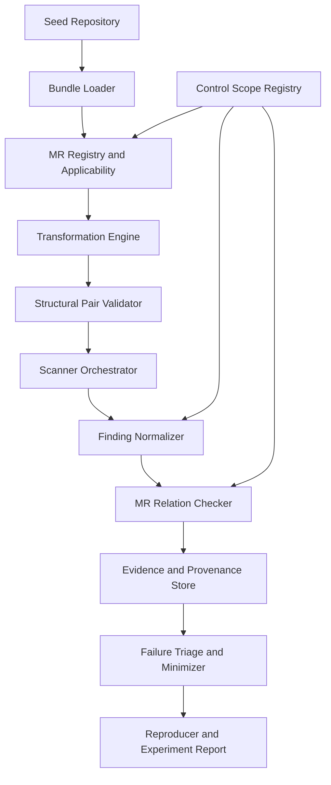

# ĐỀ XUẤT HƯỚNG NGHIÊN CỨU — PHIÊN BẢN CHI TIẾT MR-FIRST

## Phát hiện lỗi trong các công cụ quét bảo mật Kubernetes bằng Metamorphic Testing

**Tên tiếng Anh:** *Detecting Defects in Kubernetes Security Scanners Using Metamorphic Testing.*

**Đối tượng kiểm thử (SUT):** Trivy và Kubescape, trên các phiên bản/controls xác định.

**Phạm vi đề tài:** RBAC, ServiceAccount token và Workload/Pod Security. Giai đoạn đầu ưu tiên các MR có điều kiện áp dụng minh bạch, quan hệ đầu ra chặt chẽ và khả năng chạy trên scanner thật; catalog mở rộng dần theo chất lượng bằng chứng.

**Tư tưởng trung tâm:** MR vừa **sinh test cases có cấu trúc**, vừa là **test oracle dạng quan hệ**. Không xây một Semantic/Reference Oracle độc lập trong pipeline chính. Hiểu ngữ nghĩa Kubernetes vẫn là cơ sở bắt buộc để dẫn xuất MR hợp lệ; xác minh bằng API server/runtime được dành cho hướng phát triển tiếp theo.

**Tính chất tài liệu:** Bản đề xuất độc lập, giải thích từ con số 0 tới kiến trúc từng module, mô hình dữ liệu, thuật toán, ví dụ YAML, các case PoC lịch sử, nghiên cứu thực nghiệm và hợp đồng triển khai PoC mới.

**Ngày cập nhật:** 29/10/2026. **Trạng thái bằng chứng:** Các case K1–N3 và P1 thuộc giai đoạn nghiên cứu/PoC trước. Bản PoC MR-first mới (repo `k8s-mr-lab/`) **đã chạy Trivy 0.75.0 và Kubescape v4.0.15 thật** ở chế độ quét manifest; kết quả và hạn chế được ghi ở mục 21.5. Đó là bằng chứng **phát triển/hồi quy có định hướng** (DEV/REG), chưa phải khám phá mù; các ứng viên lỗi chưa được xác nhận (`CONFIRMED`). Không lấy số liệu mock làm số liệu nghiên cứu.

> **Thứ tự đọc khuyến nghị:** Phần I trả lời “bài toán là gì và vì sao cần làm”; Phần II giải thích MT và MR; Phần III trình bày cách xây MR và framework từ đầu; Phần IV giải thích PoC K1 cùng các phát hiện đã được báo cáo trước đó; Phần V trình bày RQ và giao thức đánh giá; Phần VI tóm tắt trình giảng viên; Phụ lục và Phần VII bàn giao chi tiết cho lập trình viên/coding agent. Không cần đọc tài liệu khác để nắm ý tưởng tổng thể.

---

# PHẦN I — HIỂU BÀI TOÁN TỪ CON SỐ 0

## 1. Kubernetes là gì và tại sao cần công cụ quét bảo mật?

Hãy hình dung một ứng dụng được triển khai trên Kubernetes. Thay vì khởi chạy từng container bằng tay, người vận hành mô tả trạng thái mong muốn của hệ thống trong những đối tượng cấu hình như **Pod**, **Deployment**, **ServiceAccount**, **Role**, **RoleBinding** và **NetworkPolicy**. Các đối tượng này thường được lưu dưới dạng YAML.

Ví dụ, một Pod cơ bản:

```yaml
apiVersion: v1
kind: Pod
metadata:
  name: demo
  namespace: lab-a
spec:
  containers:
    - name: web
      image: nginx:1.27
```

Khi đọc, ta thấy: `kind: Pod` cho biết loại tài nguyên; `metadata` định danh tài nguyên; `spec` mô tả điều Kubernetes cần thực hiện. Từ đây có thể mở rộng cấu hình: container có được chạy đặc quyền hay không, dùng ServiceAccount nào, được truy cập tài nguyên gì, có bị giới hạn mạng hay không.

**Misconfiguration** là tình huống cấu hình không phù hợp một yêu cầu bảo mật đã được xác định. Chẳng hạn, một tổ chức yêu cầu các container ứng dụng không được bật `privileged`; một Pod bật tùy chọn đó vi phạm yêu cầu. Tuy nhiên, việc Kubernetes **chấp nhận** cấu hình chỉ chứng minh rằng cấu hình qua được các bước kiểm tra và chính sách admission hiện hành; nó không tự chứng minh cấu hình an toàn theo mọi tiêu chuẩn.

Để không phải tự đọc hàng trăm hoặc hàng nghìn YAML, người vận hành dùng **Kubernetes security scanners**. Trong đề tài này, hai công cụ được chọn là:

- **Trivy:** có chức năng quét cấu hình hạ tầng và Kubernetes manifests để tìm các vi phạm chính sách/misconfigurations.
- **Kubescape:** có chức năng kiểm tra manifests hoặc cluster theo những frameworks và security controls.

Các scanner thường vận hành theo ý tưởng:

```text
Bộ cấu hình Kubernetes
          |
          v
  Trivy hoặc Kubescape
          |
          v
Kiểm tra theo các security controls/rules
          |
          v
Danh sách findings: vấn đề gì, tại tài nguyên nào, mức độ/chi tiết gì
```

Kết quả scanner là một **đánh giá bảo mật của công cụ**, không phải phán quyết tuyệt đối về thế giới thực.

### 1.1. Một số khái niệm cần nhớ

| Khái niệm | Cách hiểu đơn giản | Ví dụ |
|---|---|---|
| Manifest | Bản mô tả cấu hình Kubernetes | `pod.yaml`, `deployment.yaml` |
| Resource / Object | Đối tượng Kubernetes | Pod, Role, RoleBinding |
| Namespace | Phạm vi quản lý nhiều tài nguyên | `lab-a`, `lab-b` |
| ServiceAccount (SA) | Danh tính dành cho workload khi tương tác với Kubernetes API | `lab-a:app` |
| RBAC | Cơ chế cấp quyền dựa trên Role và Binding | `get pods`, `list secrets` |
| Security control | Một tiêu chí bảo mật cần kiểm tra | “Không được bật privileged” |
| Finding | Kết luận của scanner đối với một đối tượng/tiêu chí | Rule X đánh dấu FAIL |
| False positive (FP) | Scanner báo vi phạm dù theo tiêu chí đã chốt không có vi phạm | Gán nhầm quyền ở namespace khác |
| False negative (FN) | Scanner bỏ sót vi phạm mà nó có trách nhiệm phát hiện | Không kiểm tra một loại container thuộc phạm vi rule |

**Lưu ý về PASS:** Nhiều báo cáo scanner chỉ liệt kê những kiểm tra bị lỗi. Không thấy một finding **chưa chắc** đồng nghĩa với `PASS`: có thể check không được bật, bị bỏ qua, không đủ dữ liệu, hoặc thực sự đạt. Framework phải phân biệt những trường hợp này.

## 2. Vấn đề nghiên cứu không phải “Kubernetes bị cấu hình sai”, mà là “scanner có thể đánh giá sai”

Giả sử một ServiceAccount chỉ được phép đọc ConfigMap ở namespace `lab-a`. Trong Kubernetes, một RoleBinding tại `lab-a` tham chiếu đến Role cùng namespace đó. Bây giờ có thêm một Role **trùng tên** tại namespace `lab-b`, nhưng Role mới có quyền rộng hơn.

Theo ngữ nghĩa RBAC, ServiceAccount ở `lab-a` **không tự nhận** quyền từ Role ở `lab-b`, vì RoleBinding tham chiếu `Role` trong chính namespace của nó. Nếu một scanner chỉ ghép Role theo **tên** mà quên **namespace**, nó có thể báo nhầm ServiceAccount có quyền nguy hiểm.

Kết quả sai xuất hiện không phải vì Kubernetes phân quyền sai, mà vì **công cụ phân tích cấu hình sai**.

Đây là sự khác biệt quyết định của đề tài:

| Câu hỏi | Nghiên cứu cấu hình bảo mật | Nghiên cứu này |
|---|---|---|
| Đang kiểm thử ai? | Workload/cluster Kubernetes | Trivy và Kubescape |
| Đầu vào chính? | Cấu hình đưa vào cluster | Bộ cấu hình đưa vào scanner |
| Đầu ra quan tâm? | Kubernetes thực hiện điều gì | Scanner cảnh báo điều gì |
| Khi thấy bất thường? | Có thể là lỗi cấu hình hoặc nền tảng | Có thể là lỗi rule, parsing, aggregation, mapping của scanner |
| Cluster lab đóng vai trò gì? | Chính hệ thống đang được kiểm thử | Môi trường tham chiếu để kiểm chứng một phần ngữ nghĩa |

**Câu phát biểu bài toán ngắn gọn:** Cần một phương pháp tự động tạo các trường hợp cấu hình có ý nghĩa và kiểm tra xem Trivy/Kubescape có đánh giá nhất quán, đúng với ngữ nghĩa Kubernetes và đúng với những security controls mà chúng tuyên bố hỗ trợ hay không.

## 3. Tại sao phải giải quyết vấn đề này?

Có **hai khó khăn khác nhau**.

### 3.1. Khó khăn thứ nhất: Không thể nghĩ thủ công ra mọi kịch bản đáng kiểm tra

Một security check viết theo dạng “đọc trường A rồi xét giá trị B” có thể chạy tốt trên test fixture đơn giản, nhưng sai khi có nhiều đối tượng tương tác. Chẳng hạn:

- Một quyền RBAC được viết bằng nhiều rules thay vì một rule tổng hợp.
- Một quyền được cấp qua subject `User` hoặc `Group`, không chỉ `ServiceAccount`.
- Hai namespace có Role trùng tên.
- Một container nằm trong `initContainers` thay vì `containers`.
- Một thuộc tính được khai báo ở cấp Pod nhưng bị ghi đè ở cấp container.
- Token ServiceAccount được đưa vào Pod bằng một cơ chế khác với mount mặc định.

Số lượng tổ hợp tăng nhanh. Việc tự viết một YAML và một expected result cho mọi tổ hợp sẽ rất tốn kém, lại dễ bỏ sót đúng những trường hợp mà người viết test chưa từng nghĩ tới.

### 3.2. Khó khăn thứ hai: Không biết trước scanner phải xuất chính xác những finding nào

Đây là *test oracle problem* trong kiểm thử công cụ phân tích cấu hình. Một lần quét có thể trả hàng trăm findings từ nhiều controls. Để kiểm tra bằng cách truyền thống, người làm test phải viết kết quả kỳ vọng chi tiết cho từng cấu hình, control, namespace, subject và phiên bản scanner.

Ví dụ, nếu một ServiceAccount liên kết với ba Role, một ClusterRole và nhiều RoleBinding, việc xác định bảng quyền rồi lập nhãn PASS/FAIL thủ công không hề đơn giản. Nếu thay đổi một trường nhỏ, ta lại phải viết nhãn mới cho cả cấu hình. Điều này vừa tốn sức vừa dễ tạo ra *test oracle sai*.

**Metamorphic Testing chuyển câu hỏi sang quan hệ.** Thay vì luôn hỏi “trên `C1`, chính xác 17 findings nào phải xuất hiện?”, ta hỏi “nếu biến đổi `C1` thành `C2` theo một phép biến đổi được chứng minh là không ảnh hưởng đến thuộc tính quyền mục tiêu, thì findings tương ứng có được phép đổi hay không?”.

```text
Kiểm thử truyền thống: C1 ---> Scanner ---> F1 ---> So với đáp án tuyệt đối E1

Metamorphic Testing:  C1 ---> Scanner ---> F1 --+ 
                     |                          +--> MR Checker --> PASS / VIOLATION
                     +-- T_M ---> C2 --> F2 ---+
```

MR không thể được đặt tùy ý. Người thiết kế phải biết *ngữ nghĩa của thuộc tính đang xét* và *phạm vi của control*. Tuy nhiên, **không cần xây một module thứ hai có thể phán xử expected PASS/FAIL cho mọi YAML**. Chính quan hệ giữa hai kết quả là tiêu chí kiểm thử.

Có một giới hạn quan trọng: nếu scanner trả cùng một kết quả sai cho cả hai cấu hình, một MR bất biến vẫn có thể PASS. Vì vậy catalog cần nhiều kiểu quan hệ, gồm giữ nguyên và thay đổi có kiểm soát; đồng thời phải báo cáo rõ những loại lỗi phương pháp có thể bỏ sót.

### 3.3. Tại sao đây là bài toán đáng làm, không chỉ là một ý tưởng?

Nghiên cứu ISSTA 2026 về 10 Kubernetes misconfiguration scanners công bố một benchmark gồm **4.109 tệp misconfiguration cho phân tích tĩnh/động, 144 shell scripts và 281 misconfiguration riêng biệt**. Bài báo chỉ ra sự không nhất quán về tiêu chí phát hiện giữa công cụ và những khoảng trống coverage. Đây là động lực thực nghiệm cho việc kiểm thử độ tin cậy của scanner, **không phải** bằng chứng rằng mọi scanner đều sai với mọi policy. Con số 43,8% và 62,3% được mô tả trên trang hội nghị là **accuracy** của Kubescape trong hai chế độ, không được tùy tiện đổi tên thành recall.

Một bằng chứng cụ thể khác là issue công khai **kubescape/kubescape #2579**, mô tả lỗi ghép Role với RoleBinding giữa các namespace khi chỉ dựa vào `roleRef.kind` và `roleRef.name`. Đây là ví dụ rõ về scanner defect, độc lập với việc cấu hình Kubernetes có hợp lệ hay không.

**Khoảng trống mà đề tài nhắm tới:** không chỉ đánh giá scanner bằng một tập benchmark cố định, mà thiết kế cách **tự động tạo thêm những tình huống có cấu trúc**, rồi **xác minh** các trường hợp scanner phản ứng sai hoặc không nhất quán.

---

# PHẦN II — METAMORPHIC TESTING LÀ GÌ?

## 4. Hiểu Metamorphic Testing qua ví dụ rất đơn giản

Trong kiểm thử truyền thống, ta đưa **một đầu vào** vào chương trình và so sánh **một đầu ra** với đáp án được biết trước.

Ví dụ, một chương trình tính tổng nhận `(2, 3)` thì kết quả mong đợi là `5`. Nhưng với hệ thống phức tạp, ta có thể không biết chính xác đầu ra cho từng đầu vào.

Metamorphic Testing (MT) thay đổi cách đặt câu hỏi:

> Thay vì luôn hỏi “đầu ra tuyệt đối phải bằng bao nhiêu?”, ta hỏi “nếu tôi thay đổi đầu vào theo một quy luật đã biết, đầu ra **phải có quan hệ như thế nào** với đầu ra trước đó?”.

Ví dụ một chức năng sắp xếp mảng: nếu hoán đổi thứ tự các phần tử đầu vào, kết quả sắp xếp vẫn phải giống nhau. Ta có thể thử nhiều mảng mà không phải tự viết trước kết quả đúng cho từng mảng.

**Bản chất MT:** kiểm tra *quan hệ* giữa ít nhất hai lần thực thi của hệ thống đang được kiểm thử.

### 4.1. Source input, follow-up input và MR

Giả sử cấu hình ban đầu là `C₁`. Ta áp dụng một phép biến đổi `T` để tạo ra cấu hình mới `C₂`:

$$C_2 = T(C_1)$$

Sau đó chạy scanner `S` trên cả hai:

$$F_1 = S(C_1),\qquad F_2 = S(C_2)$$

**Metamorphic Relation (MR)** là quy tắc mô tả quan hệ cần thỏa mãn giữa hai lần chạy. Ví dụ: “Nếu chỉ đổi thứ tự các key trong YAML mà không đổi nội dung object, các findings về bảo mật phải giữ nguyên sau khi chuẩn hóa”.

Ta có thể viết:

$$Semantic(C_1)=Semantic(C_2)\;\Longrightarrow\;N(F_1)=N(F_2)$$

Ở đây `N` là bước chuẩn hóa findings — bỏ những khác biệt không có ý nghĩa như số dòng, đường dẫn file tạm hoặc thứ tự hiển thị.

**Không phải mọi biến đổi đều là MR hợp lệ.** Phép biến đổi và quan hệ kỳ vọng phải đi đôi với những điều kiện áp dụng đủ chặt.

### 4.2. Hai loại quan hệ biến hình

**Loại A — Bất biến (*semantic-preserving* đối với thuộc tính đang xét).** Ta thay đổi biểu diễn nhưng không đổi trạng thái bảo mật có liên quan; những findings tương ứng phải giữ nguyên. Ví dụ: đổi thứ tự key trong YAML, hoặc thêm một Role không liên quan ở namespace khác.

**Loại B — Thay đổi có kiểm soát (*semantic-changing*).** Ta chủ động làm một thuộc tính bảo mật thay đổi và dự đoán **check cụ thể** phải phản ứng thế nào. Ví dụ: với control kiểm tra privileged container, đổi `privileged: false` thành `privileged: true` có thể làm trạng thái của control đó chuyển từ đạt sang vi phạm.

Đừng diễn giải loại B là “cứ thêm một cấu hình nguy hiểm thì tổng số cảnh báo phải tăng”. Điều đó sai vì các controls có điều kiện, có thể trùng lặp, hoặc scanner không đánh giá được một phần dữ liệu. Chỉ nên so **đúng property, đúng policy, đúng resource**.

## 5. Ví dụ từ dễ đến khó

### 5.1. Ví dụ 1 — Đảo thứ tự key YAML

**Manifest gốc:**

```yaml
apiVersion: v1
kind: Pod
metadata:
  name: sample
  namespace: lab-a
spec:
  containers:
    - name: app
      image: nginx:1.27
      securityContext:
        privileged: false
```

**Manifest biến đổi:**

```yaml
kind: Pod
metadata:
  namespace: lab-a
  name: sample
apiVersion: v1
spec:
  containers:
    - securityContext:
        privileged: false
      image: nginx:1.27
      name: app
```

Hai manifest biểu diễn cùng một object. Nếu một scanner đổi verdict chỉ vì vị trí key, khả năng cao có vấn đề trong parser hoặc logic xử lý input.

**Tại sao cần thận trọng?** Chỉ được đảo key của *mapping*, không tùy tiện đảo các phần tử của *list*; không dùng YAML có key trùng. Nếu thay đổi ngữ nghĩa thật rồi vẫn mong output giữ nguyên, chính MR đã sai.

### 5.2. Ví dụ 2 — Đổi một thuộc tính bảo mật

Ta xét một control **chỉ chuyên kiểm tra** xem container có bật `privileged` hay không.

```yaml
# Cấu hình nguồn
securityContext:
  privileged: false
```

Biến đổi thành:

```yaml
# Cấu hình theo sau
securityContext:
  privileged: true
```

Khi kiểm tra control tương ứng, kỳ vọng là:

```text
Cấu hình nguồn:    control không thấy vi phạm privileged
Cấu hình theo sau: control phải nhận ra privileged=true
```

Nếu công cụ không phát hiện mà control đó thực sự được bật và áp dụng, ta có một **ứng viên false negative** cần xác minh. Nếu scanner không cung cấp trạng thái PASS rõ ràng, phải suy ra bằng metadata coverage và kết quả đánh giá rule, chứ không dựa vào việc vắng mặt finding.

### 5.3. Ví dụ 3 — Từ việc sửa một trường đến việc kiểm tra quan hệ giữa nhiều resource

Bây giờ xét RBAC. Một quyền không được xác định chỉ bởi một trường đơn lẻ. Nó hình thành qua quan hệ **ServiceAccount → RoleBinding → Role → PolicyRules**. Nếu có nhiều namespace và Role trùng tên, một scanner thực hiện phép ghép đối tượng không đúng sẽ đưa ra kết luận sai.

Đây là loại trường hợp khó hơn nhưng cũng là nơi Metamorphic Testing có thể hữu ích nhất: thay đổi **cấu trúc quan hệ giữa nhiều resource**, không chỉ đổi một Boolean.

## 6. Metamorphic Relation được xây dựng bằng những thành phần nào?

Một MR không chỉ là lệnh sửa YAML. Tài liệu đề xuất biểu diễn nó bằng **bốn yếu tố dễ kiểm tra**:

\[
MR=(Precondition,Transformation,ExpectedRelation,Scope)
\]

| Yếu tố | Câu hỏi cần trả lời | Ví dụ với RBAC |
|---|---|---|
| `Precondition` | Cấu hình nào được dùng? | RoleBinding ở `lab-a` tham chiếu một Role cùng namespace và subject cụ thể |
| `Transformation` | Thay đổi chính xác cái gì? | Thêm Role trùng tên tại `lab-b`, không tạo Binding |
| `ExpectedRelation` | Hai lần quét phải liên hệ thế nào? | Verdict của control về quyền *subject mục tiêu* không đổi |
| `Scope` | So sánh cái gì và loại trừ điều gì? | Chỉ control đánh giá effective permissions của target SA, không so mọi finding của Role mới |

**Cơ sở xây dựng MR** là kiến thức về RBAC, cấu trúc workload và yêu cầu từng security control. Đây là *lý do chọn precondition và expected relation*, **không phải** một Semantic Oracle chạy song song trong mọi lượt test.

### 6.1. Hình thức hóa phép kiểm thử

Đặt `C1` là cấu hình đầu vào, `T_M` là transformation của MR `M`, `C2=T_M(C1)`, `S` là scanner và `N_P` là bộ chuẩn hóa/chiếu findings lên control và thuộc tính mục tiêu `P`.

\[
Pre_M(C_1,P)\land StructValid_M(C_1,C_2)
\;\Longrightarrow\;
R_M\big(N_P(S(C_1)),N_P(S(C_2))\big)
\]

Ở đây `StructValid_M` là kiểm tra điều kiện cấu trúc và tính đúng của *phép biến đổi* (ví dụ không vô ý thêm RoleBinding), **không phải** module tính một expected verdict độc lập. `R_M` có thể là `equal`, `pass_to_fail`, `fail_to_pass`, `subset` hoặc một predicate chuyên biệt theo control.

Nếu không xác định được precondition, scope hoặc hai verdict không so được, không được đánh PASS. Kết quả phù hợp phải là `SKIP`, `INVALID_PAIR` hoặc `INCONCLUSIVE` với nguyên nhân.

### 6.2. Hai dạng MR quan trọng

**Invariance MR:** Một thay đổi ở input nhưng không thay đổi thuộc tính liên quan; kết quả ở đúng control/resource phải không đổi. Ví dụ hoán đổi mapping keys, tách RBAC rule hoặc thêm Role decoy khác namespace.

**Controlled-change MR:** Một thuộc tính chuyển theo chiều đã biết và một control cụ thể phải phản ánh đúng. Ví dụ chuyển `privileged: false` thành `true` dưới một control chỉ kiểm tra việc bật privileged, nếu đã xác minh phiên bản scanner và coverage của control. Không suy ra tổng số cảnh báo tăng.

### 6.3. Vì sao mỗi MR phải có precondition?

Xét phép biến đổi `ServiceAccount` thành `Group system:serviceaccounts:<namespace>` trong RoleBinding. Quyền của một ServiceAccount nhất định có thể vẫn vậy, nhưng quyền của những ServiceAccount khác sẽ tăng. Quan hệ “toàn bộ tình trạng RBAC không đổi” là sai. Chỉ khi giới hạn vào đúng subject và control kiểm tra subject đó, MR mới có thể phù hợp.

Ví dụ khác: tách `rules` chứa hai verbs thường bảo toàn tập quyền, nhưng một control chuyên kiểm tra *hình dạng* một policy rule có thể đổi kết quả vì số rules thay đổi. Phải phân biệt ngữ nghĩa quyền với biểu diễn cấu hình.

### 6.4. Kiểm tra MR khác với xác nhận bug

Một kết quả `VIOLATION` có nghĩa scanner không thỏa quan hệ đã đặc tả, **chưa tự chứng minh false positive hay false negative**. Người nghiên cứu còn phải kiểm tra policy scope, dữ liệu đã quét, phiên bản scanner, độ tin cậy của normalizer và khả năng tái hiện. Giai đoạn điều tra lỗi không đồng nghĩa việc dựng một oracle chạy song song trong pipeline chính.

# PHẦN III — PHƯƠNG PHÁP NGHIÊN CỨU: TỪ Ý TƯỞNG ĐẾN HỆ THỐNG CÓ THỂ TRIỂN KHAI

## 7. Xác định rõ đối tượng và giới hạn nghiên cứu

**SUT (System Under Test) là Trivy/Kubescape**, không phải Kubernetes API server. Framework kiểm thử cách scanner phân tích các objects cấu hình hoặc cluster state, ánh xạ object vào controls và xuất findings. Kubernetes là **miền tri thức** để xây MR; có thể dùng môi trường lab để thực thi scanner khi mode yêu cầu nhưng **không chạy SAR hay runtime reference oracle trong thiết kế cốt lõi**.

| Thành phần | Nghĩa trong đề tài | Trách nhiệm |
|---|---|---|
| `ConfigBundle` | Tập đối tượng K8s liên hệ với nhau | Source input đầy đủ, không mất quan hệ SA–Role–Binding |
| `MR` | Quy tắc biến đổi và quan hệ đầu ra | Sinh test, chấm tính nhất quán |
| `Scanner Adapter` | Gọi Trivy/Kubescape phiên bản cụ thể | Thu report thật từ một mode được pin |
| `Normalizer` | Chuẩn hóa findings trên đúng control/resource | Loại khác biệt vô nghĩa nhưng giữ thuộc tính liên quan |
| `MR Checker` | Tính `R_M(F1,F2)` | Phân loại PASS/VIOLATION/INCONCLUSIVE |
| `Triage` | Điều tra trường hợp bất nhất | Tái hiện, phân biệt lỗi framework và scanner |

### 7.1. Hai chế độ quét, tránh một mâu thuẫn thực nghiệm phổ biến

**Local manifest mode:** Đưa bộ YAML từ thư mục đầu vào vào scanner. Đây là cách thích hợp cho MR về cú pháp YAML, thuộc tính Pod hoặc rule-level nếu phiên bản scanner thực sự hỗ trợ control đó trên file scan. Có thể chạy trên máy không có cluster.

**Live-cluster mode:** Một số controls liên quan RBAC aggregation, linked objects hoặc policy chạy đúng ngữ cảnh cluster; các reproducer trước đây có thể đã chạy trên mode này. Khi cần tái hiện K1/K2 bằng Kubescape, **phải kiểm tra mode gốc thực sự chạy được**, không mặc định bản local scan tương đương. *Cập nhật từ PoC MR-first:* trên Kubescape v4.0.15, K1 (control `C-0267`/`C-0272`) **tái hiện được ở chế độ quét manifest** vì rule rego chạy trên chính các object trong thư mục quét; chế độ live-cluster không cần cho PoC và được để cho giai đoạn mở rộng. Chạy trên cluster lab riêng, kiểm soát namespace, cleanup, snapshot và versions. Đây là chế độ scanner, **không phải dựng một Semantic Oracle độc lập**.

Kết quả của hai chế độ không được trộn chung vào một tỷ lệ, bởi source input, tập object mà scanner thấy và controls thực thi có thể khác nhau.

### 7.2. Phạm vi giai đoạn đầu và những việc không làm

Đề tài đặt phạm vi kiến thức ở ba miền: **RBAC, ServiceAccount token, Pod Security**. Tuy nhiên, mức độ hoàn chỉnh phụ thuộc khả năng xây MR đúng cho từng miền. Khởi đầu nên triển khai MR chắc chắn và dễ tái hiện: YAML reorder, decoy Role khác namespace, RBAC rule decomposition, privileged change và API group change. Một số case token và `securityContext` phức tạp được giữ trong catalog nghiên cứu nhưng chỉ kích hoạt khi policy scope và precondition được mô tả đủ.

Không tự viết scanner bảo mật mới; không xây DSL/Java compiler riêng; không xây reference-verdict engine; không nhận kết quả của mock scanner làm bằng chứng thực nghiệm; không cam kết kiểm thử toàn bộ Kubernetes hoặc tìm mọi misconfiguration.

### 7.3. Giả thuyết nghiên cứu — không được biến thành kết luận trước khi đo

**H1:** Các MR dựa trên *điểm đa biểu diễn và tương tác tài nguyên* của Kubernetes có thể sinh được những test cases hữu ích để phát hiện defect của scanner.

**H2:** Các MR có precondition và scope đầy đủ làm giảm những alert không hợp lệ do biến đổi sai hoặc chuẩn hóa sai, so với MR sơ sài không kiểm applicability.

**H3:** Chi phí chạy một cặp MR (sinh follow-up, hai lượt quét scanner thật, chuẩn hóa, kiểm tra quan hệ) đủ thấp để áp dụng tự động trên tập seed cỡ nhỏ-vừa, và khối lượng triage thủ công (số alert sau khử trùng) ở mức một người nghiên cứu xử lý được; đây là **giả thuyết cần đo** (RQ3 — Efficiency & Practicality). Đề tài **không** đặt giả thuyết "MR-guided tốt hơn random/schema-aware"; so sánh đó thuộc Future Work (Phụ lục E, mục E.6).

## 8. Mô hình toán học của phương pháp MR-first

Cho một scanner `S` (phiên bản và policy bundle cố định), cấu hình source `C`, MR `M=(Pre,T,R,Scope)` và thuộc tính mục tiêu `P`:

\[
C' = T_M(C),\qquad Y=S(C),\quad Y'=S(C').
\]

Bước chuẩn hóa `N_{S,P}` chọn đúng finding trên đúng subject, resource và control, đồng thời loại thông tin phụ thuộc trình bày như line number hoặc timestamp.

\[
ValidPair_M(C,C')=Pre_M(C,P)\land StructuralChecks_M(C,C')
\]

\[
ValidPair_M(C,C')\Longrightarrow
R_M\left(N_{S,P}(Y),N_{S,P}(Y')\right)=\mathrm{True}.
\]

Nếu `R_M = False` trên cặp hợp lệ và verdicts quan sát được, ghi **MR violation**. Nếu thiếu verdict/coverage hoặc không đủ chứng cứ về cặp, ghi `INCONCLUSIVE`/`INVALID_PAIR`, không suy diễn.

### 8.1. Quan hệ `equal` và `change` không giống nhau

- **`equal`**: các verdicts tương đương trên control/resource mục tiêu. Không được so report toàn cục nếu phép biến đổi thêm một object mới và object đó hợp lệ có finding riêng.
- **`pass_to_fail` / `fail_to_pass`**: một control được xác nhận phải phản ứng theo thay đổi cụ thể, chẳng hạn `privileged: false → true`. Nếu scanner chỉ xuất các FAIL, thiếu finding không tự động là PASS.
- **`subset` / `superset`**: chỉ áp dụng khi control có outputs theo cấu trúc tập hợp và quan hệ bao hàm đã xác định. Không suy ra quan hệ bao hàm findings từ việc quyền Kubernetes tăng vì quy tắc policy có thể phi đơn điệu.

### 8.2. Ví dụ lỗi nhất quán mà MR bất biến bỏ sót

Giả sử Trivy bỏ qua `apiGroups` và luôn kết luận một subject có quyền đối với Secrets khi gặp chuỗi `resources: ["secrets"]` dù API group là `apps`. Nếu chỉ đổi thứ tự key, scanner sai giống nhau cả trước/sau; quan hệ `equal` vẫn thỏa. Một **MR controlled-change** đổi `apiGroups: [""]` sang `["apps"]` trong điều kiện đã xác nhận scope sẽ có khả năng phát hiện vấn đề này.

Nhưng không được mặc định việc đổi API group phải đổi verdict với mọi controls: chỉ những controls thực sự kiểm tra quyền core Secrets của subject đã mapping mới thuộc phạm vi MR.

### 8.3. Chọn đầu vào — không phải mọi cặp biến đổi đều là test case hữu ích

Nếu seed không có RoleBinding hoặc control không áp dụng, case được `SKIP`. Nếu phép biến đổi vô tình tạo thêm Binding, cặp sai, đánh `INVALID_PAIR`. Nếu không quan sát được status ở một trong hai lần quét, `INCONCLUSIVE`. Đây là các trạng thái thành công của **quy trình phân loại chính xác**, không phải lỗi của runner.

## 9. Cách xây dựng Metamorphic Relations từ kiến thức Kubernetes

Một trở ngại thường gặp là nhìn vào YAML rồi tự nghĩ ra hàng trăm phép đổi `true/false`. Cách này tạo nhiều biến thể nhưng không chắc phát hiện được lỗi sâu trong scanner. Đề tài cần một quy trình **dẫn xuất MR có nguyên tắc**:

1. Chọn **security property** quan trọng và một control có tuyên bố kiểm tra nó. Ví dụ: không gán nhầm quyền của Role sang namespace khác.
2. Xác định **ngữ nghĩa Kubernetes** của property: đối tượng nào liên quan, thuộc tính nào quyết định, quan hệ tham chiếu nào hợp lệ.
3. Tìm các **semantic variation points**: những cách biểu diễn khác nhau hoặc những thay đổi có chủ đích vào các điều kiện liên quan.
4. Quyết định MR là **bất biến** hay **thay đổi có kiểm soát**. Không được mặc định hai cấu trúc khác nhau thì tương đương.
5. Viết **precondition** đủ mạnh, với phạm vi subject/resource/control cụ thể.
6. Đặc tả **transformation** dưới dạng hàm xác định và có thể truy vết.
7. Viết **expected output relation** sau khi chuẩn hóa kết quả scanner.
8. Viết **lập luận tính đúng của MR** từ quy tắc Kubernetes và tiêu chí control; trong MVP chỉ kiểm những điều kiện mà generator có thể xác nhận, không yêu cầu SAR/runtime oracle.
9. Tạo ít nhất một **positive example** (MR hợp lệ) và một **counterexample** (trường hợp tưởng hợp lệ nhưng thực ra không).
10. Chạy thử MR trên các scanner và lưu **giới hạn áp dụng** ngay trong catalog.

### 9.1. Taxonomy R1–R10: Nên sinh test ở đâu?

Đây là **taxonomy do đề tài đề xuất**, không phải tài liệu phân loại chính thức của Kubernetes. Một nhóm là **không gian để thiết kế biến đổi**, không có nghĩa mọi cách biểu diễn trong nhóm đều tương đương.

| Nhóm | Biến thể cần thử | Ngữ nghĩa cần kiểm chứng | Rủi ro của scanner |
|---|---|---|---|
| R1 — Subject identity | ServiceAccount, User mang tên hệ thống, Group | Danh tính và group membership khi authorization | Bỏ sót hoặc ghép sai subject |
| R2 — Binding scope | RoleBinding, ClusterRoleBinding, Role, ClusterRole | Namespace scope so với cluster scope | Nhầm quyền cục bộ/thành toàn cục |
| R3 — RBAC rules | Gộp/tách verbs, apiGroups, resourceNames | Permission tuples thực sự được cấp | Bỏ qua API group hoặc cấp quyền quá mức trong đánh giá |
| R4 — Role resolution | Role trùng tên khác namespace; roleRef.kind | Role nào thực sự được binding tham chiếu | Cross-namespace / wrong-kind pairing |
| R5 — Token placement | `automountServiceAccountToken`, projected volume | Token nào có thể được workload truy cập | Chỉ kiểm tra một đường biểu diễn token |
| R6 — Container type | Normal/init/ephemeral container | Rule có áp dụng cho loại container đó không | Bỏ sót một vị trí trong Pod spec |
| R7 — Workload wrapper | Pod/Deployment/Job/CronJob... | Pod template và controller behavior | Không duyệt hết các đường Pod template |
| R8 — SecurityContext inheritance | Pod-level và container-level | Giá trị hiệu lực và override | Bỏ qua ghi đè nguy hiểm |
| R9 — Capabilities | `privileged`, `add`, `drop` | Quan hệ trường và hiệu lực runtime | Đánh giá từng trường riêng rẽ, bỏ tương tác |
| R10 — Scope narrowing | `resourceNames`, subresources, namespace labels | Phạm vi chính xác của action hoặc policy | Coi quyền giới hạn tên là quyền toàn resource |

Với mỗi nhóm, nên lưu ba trường metadata bổ sung: `semantic_property`, `candidate_controls`, `known_non_equivalences`. Ví dụ R6 ghi rõ normal container và init container **không tương đương về vòng đời**. Chỉ những controls có tiêu chí áp dụng chung cho thuộc tính tương ứng mới có MR bất biến hợp lệ.

### 9.2. Từ taxonomy đến các MR có thể thực thi

Taxonomy R1–R10 chỉ định **nơi cần chú ý**; từ đó mới thiết kế một MR có source, precondition, transformation, expected relation và phạm vi control. Không phải cứ một taxonomy group có thể tạo ra một MR hợp lệ bằng cách đổi trường tùy ý.

| MR | Nhóm | Source & precondition | Transformation | Relation cần kiểm | Mức ưu tiên |
|---|---|---|---|---|---|
| MR-01 — YAML key order | Cú pháp | Bundle không duplicate mapping keys | Hoán đổi thứ tự mapping keys | `equal` trên cùng resource/control | MVP |
| MR-02 — Decoy same-name Role | R4 | RoleBinding trỏ Role local, target SA rõ | Thêm Role trùng tên khác namespace, không binding | `equal` trên subject và control quyền mục tiêu | MVP, local/live tùy control |
| MR-03 — Rule decomposition | R3 | Rule chứa nhiều verbs, field khác giữ nguyên | Tách verbs thành hai rules | `equal` cho control dựa quyền hiệu lực | MVP |
| MR-04 — Privileged flip | R9 | Container thuộc scope control, `privileged:false` | Đổi thành `true` | `pass_to_fail` ở control privileged được pin | MVP có điều kiện |
| MR-05 — API group switch | R3 | Core Secrets permission là quyền mục tiêu duy nhất liên quan | Đổi API group core thành `apps` | `fail_to_pass` cho control đọc core Secrets | MVP có điều kiện |
| MR-06 — Identity form | R1 | SA identity và subject mapping đủ rõ | Biểu diễn SA identity bằng User phù hợp | `equal` *chỉ* ở target SA | Giai đoạn 2 |
| MR-07 — Token representations | R5 | Control thật sự đánh giá khả năng có SA token | Đổi cơ chế khai báo token trong giới hạn rõ | `equal` hoặc `change` theo **property được định nghĩa** | Giai đoạn 2 / hạn chế |
| MR-08 — Container override | R8 | Control kiểm giá trị hiệu lực, scope rõ | Chuyển field cấp Pod thành override có chủ đích | `change` trên control được pin | Giai đoạn 2 |
| MR-09 — Init container scope | R6 | Control tài liệu áp dụng cả init container | Đặt thuộc tính liên quan ở init container | Quan hệ chuyên biệt theo control | Giai đoạn 2 |
| MR-10 — resourceNames | R10 | Control phân biệt named vs unrestricted get | Thêm resourceNames với tên cụ thể | Quan hệ chuyên biệt, không đồng nhất verbs | Giai đoạn 2 / nghiên cứu |

**Vì sao không đưa cả 10 MR vào MVP ngay?** Có các quan hệ đòi hỏi thông tin về actual token/Pod admission hoặc điều kiện policy khó xác định chỉ từ YAML. Tự ép chúng thành `invariant` có thể tạo hàng loạt cảnh báo giả. Giữ các mục ấy làm *candidate MR*, triển khai sau khi mô tả được precondition, matcher và negative examples đủ chặt; không dựng runtime oracle chỉ để hợp thức hóa một MR quá yếu.

### 9.2.1. Chọn MR nào phù hợp scanner nào?

Một MR cần **control mapping riêng cho từng phiên bản**. Ví dụ MR-02 chỉ đánh giá control kiểm quyền của subject sau khi resolve Roles; nếu control quét mọi Role độc lập, Role mới được thêm vào có thể tạo finding hợp lệ nhưng không liên quan đến MR-02. Không suy luận mapping chỉ từ tên rule. Cần đọc tài liệu control và ít nhất một report JSON thật, ghi `scanner/version/mode/control_id/resource_scope/notes`.

Nếu scanner hỗ trợ kiểm tra quyền bằng live cluster nhưng không có đúng control đó trong local scan, chạy local rồi báo thiếu finding sẽ tạo lỗi nghiên cứu giả. Lúc ấy chọn mode live-scanner được pin hoặc `NOT_APPLICABLE`.

### 9.3. Ví dụ đầy đủ MR-01 — Đảo thứ tự YAML (dễ nhất)

Source:

```yaml
apiVersion: v1
kind: Pod
metadata: {name: demo, namespace: lab-a}
spec:
  containers:
    - name: app
      image: nginx:1.27
      securityContext: {privileged: false}
```

Follow-up:

```yaml
kind: Pod
metadata:
  namespace: lab-a
  name: demo
apiVersion: v1
spec:
  containers:
    - securityContext: {privileged: false}
      image: nginx:1.27
      name: app
```

**Precondition:** Cả hai parse được thành cùng cấu trúc object, không có duplicate keys và không thay đổi thứ tự phần tử các trường dạng sequence. **Transformation:** chỉ sắp xếp lại mapping keys/format. **Expected relation:** các findings theo `control-id, resource-id, status, semantic-attributes` không đổi, cho phép line number và vị trí xuất hiện trong báo cáo thay đổi. **Oracle:** so equality của object sau parse, không cần khởi chạy cluster. **Lỗi có thể bắt:** scanner phụ thuộc thứ tự key hoặc vị trí văn bản thay vì dữ liệu cấu hình.

Nếu một tool thêm thông tin source location, raw JSON có thể khác mà vẫn **không phải** lỗi. Đó là lý do cần `FindingNormalizer`.

### 9.4. Ví dụ đầy đủ MR-03 — Tách/gộp RBAC rules

Source:

```yaml
rules:
  - apiGroups: [""]
    resources: ["pods"]
    verbs: ["get", "list"]
```

Follow-up:

```yaml
rules:
  - apiGroups: [""]
    resources: ["pods"]
    verbs: ["get"]
  - apiGroups: [""]
    resources: ["pods"]
    verbs: ["list"]
```

**Giải thích:** Vì Kubernetes RBAC cộng dồn quyền, hai biểu diễn cho cùng tập quyền `get/list pods` khi không thay đổi các yếu tố khác. **Precondition:** cùng namespace, apiGroups, resources, resourceNames, nonResourceURLs và bindings; không áp dụng quan hệ này cho control kiểm **hình thức rule** hoặc giới hạn số rules. **Expected relation:** findings phụ thuộc **effective permissions** bất biến. **Evidence:** so tập quyền được mô tả và có thể kiểm chứng bằng authorization queries đại diện.

Phản ví dụ: thay một rule bằng wildcard `*` **không mặc nhiên tương đương** với việc liệt kê các verbs hiện tại, vì wildcard có thể áp dụng cho những quyền hoặc tài nguyên xuất hiện về sau.

### 9.5. Ví dụ đầy đủ MR-04 — Thay đổi thuộc tính privileged

Source có container áp dụng `privileged: false`; follow-up chuyển thành `privileged: true`. Đây là **semantic-changing MR**. **Precondition:** control thực sự áp dụng trên loại container và profile kiểm thử; API/schema hợp lệ; có điều kiện an toàn và testbed phù hợp; không bị loại khỏi phạm vi đánh giá của policy. **Expected relation:** **check privileged đã mapping** phải phản ánh giá trị `true` theo đặc tả. **Không nên kết luận:** “Tổng số lỗi phải tăng” hoặc “cả cluster phải trở nên không an toàn” — hai mệnh đề này quá rộng.

Ví dụ kết quả minh họa (không phải log thực nghiệm):

```text
C1: control_privileged = PASS
C2: control_privileged = FAIL
=> MR thỏa nếu control áp dụng đúng và policy coi privileged=true là vi phạm.
```

Nếu scanner chỉ xuất các findings thất bại, cần xác minh check được **thực sự thực thi** ở C1 trước khi suy ra PASS.

### 9.6. Ví dụ MR-05 — Tại sao đổi `apiGroups` kiểm thử được một lỗi khác dạng bất biến?

Giả sử một rule nguồn cấp quyền `list secrets` thuộc core API group:

```yaml
rules:
  - apiGroups: [""]
    resources: ["secrets"]
    verbs: ["list"]
```

Follow-up được tạo bằng việc chỉ thay API group:

```yaml
rules:
  - apiGroups: ["apps"]
    resources: ["secrets"]
    verbs: ["list"]
```

`secrets` của Kubernetes nằm trong core API group, vì thế rule follow-up không còn cấp quyền `list` đối với core Secrets. Nếu một control đánh giá **đúng quyền đó**, đã chạy trên cả hai configs và không có quyền khác che khuất, một quan hệ `FAIL → PASS` có thể hợp lệ. Phải chứng minh mapping và sự độc nhất của quyền liên quan. Đây không phải quan hệ tổng quát cho mọi control RBAC.

**Điểm đặc biệt:** MR bất biến có thể không phát hiện một scanner diễn giải sai giống nhau ở hai configs. MR-05 tạo một biến đổi *thay đổi có kiểm soát* để khai thác hướng lỗi ấy.

### 9.7. Những MR ngoài MVP: token, init container và securityContext

**Token:** Với `automountServiceAccountToken` và projected token volume, hai YAML nhìn có vẻ tương đương về khả năng sử dụng token, nhưng thực tế còn khác `audience`, `path`, volumeMount và admission/defaulting. Không được đưa ra một MR bất biến chung cho mọi token controls. Giai đoạn đầu chỉ giữ seed và candidate transformation; khi đã mô tả được scope và quy tắc độc lập từ đặc tả control mới triển khai.

**Pod/Container `securityContext`:** Trường cấp container có thể ghi đè field cấp Pod. Một MR thay đổi có kiểm soát có thể kiểm việc scanner ưu tiên container-level override, nhưng chỉ áp dụng cho rule đánh giá giá trị hiệu lực và workload type được hỗ trợ. Ví dụ `runAsNonRoot:true` ở Pod không đủ nếu container có `runAsNonRoot:false` với cấu hình tương ứng. Không cần chạy một Reference Oracle như bước bắt buộc, nhưng cần hiểu đúng field semantics khi viết MR.

**Normal/init/ephemeral containers:** Không phải ba loại container tương đương về vòng đời và admission. Nếu một policy tuyên bố áp dụng cùng thuộc tính lên các loại container, ta có thể xây MR về scope/coverage. Tài liệu control và schema phiên bản cụ thể quyết định precondition; không chuyển normal container sang init container rồi mặc định toàn bộ findings phải giống nhau.

### 9.8. Mẫu đánh giá tính đúng của một MR trước khi nhập catalog

Với mỗi MR phải có: (i) property và nguồn quy tắc; (ii) ví dụ áp dụng được; (iii) một phản ví dụ đủ sức làm precondition thất bại; (iv) biến đổi thực hiện đúng diff; (v) output matching không gây mất resource identity; (vi) test với scanner thật; (vii) tài liệu giới hạn. Nếu thiếu bất kỳ điều kiện nào, đánh MR là **candidate** chứ không đưa vào bảng kết quả chính.

## 10. Đặc tả MR thành đối tượng có thể thực thi

Để framework dùng lại được cho nhiều scanners và nhiều MR, cần tách MR definition khỏi CLI runner. Không viết một script khổng lồ vừa sửa YAML vừa gọi scanner rồi tự đọc JSON. **Metadata** xác định *muốn kiểm tra thuộc tính nào*; **implementation** biến đổi YAML; **checker** kiểm quan hệ output.

### 10.1. Ví dụ đặc tả MR-02 dưới dạng YAML

```yaml
id: MR-02
name: add-unbound-same-name-role
category: R4
property: target_subject_effective_permissions
relation: invariant
scope:
  entity: ServiceAccount
  control_mode: effective_permission_controls_only
  scanner: version_pinned
preconditions:
  - has_namespaced_rolebinding_to_local_role
  - has_target_serviceaccount
  - no_preexisting_conflicting_objects
transform:
  operation: rbac.add_unbound_same_name_role
  params:
    namespace: fresh_namespace
    permission_profile: widened_decoy
pair_checks:
  - source_unchanged
  - rolebinding_and_target_subject_unchanged
  - exactly_one_decoy_role_added
  - decoy_role_has_no_new_binding
output_checker:
  predicate: equal_on_target_control_and_subject
  missing_verdict: inconclusive
limits:
  - not_applicable_to_controls_that_audit_all_roles
  - cluster_scan_may_be_required_by_selected_control
```

`pair_checks` là những điều kiện nội tại của phép biến đổi, kiểm bằng phân tích các objects vừa sinh. Không sử dụng nó để tính expected findings của scanner như một reference engine.

### 10.2. Interface Python minh họa — chưa phải API thư viện có sẵn

```python
class MetamorphicRelation:
    id: str
    def applicable(self, source, control_scope) -> bool:
        """Kiểm tra precondition và phạm vi control."""
    def generate_parameters(self, source, max_cases):
        """Sinh các tham số cho transformation."""
    def transform(self, source, params):
        """Trả follow-up mới và transformation trace."""
    def validate_pair(self, source, followup, trace):
        """Kiểm thay đổi đúng dự kiến; không gọi external oracle."""
    def compare(self, source_verdicts, followup_verdicts, mapping):
        """Đánh giá quan hệ PASS/VIOLATION/INCONCLUSIVE."""
```

`applicable()` không được chỉ trả `True` vì YAML chứa một trường mong muốn. Nó cần kiểm thêm namespace, identity, mode, property và loại control. `transform()` phải clone source và ghi diff xác định. `validate_pair()` phải phát hiện thay đổi ngoài phạm vi. `compare()` chỉ nhận normalized verdict và mapping, không đoán lại ngữ nghĩa Kubernetes bằng scanner code.

### 10.3. Cách hình thành một MR mới theo từng bước

Ví dụ muốn xây MR cho RBAC rule decomposition. Đầu tiên đọc mô hình cộng dồn quyền RBAC; xác định việc chia một rule có cùng `apiGroups`, `resources`, `resourceNames` và `verbs` thành hai rules chứa từng verb không đổi tập quyền trong scope hiện tại. Sau đó viết precondition bảo toàn các trường còn lại; tạo hai YAML source/follow-up; chọn control thực sự dựa trên quyền hiệu lực; định nghĩa `equal` cho đúng chủ thể và control; cuối cùng tự viết một counterexample — chẳng hạn control kiểm số lượng rules — để xác nhận filter từ chối. Chỉ sau đó mới thêm MR vào catalog.

## 11. Mô hình dữ liệu — Từng đối tượng chứa gì và vì sao cần?

Một framework dùng để nghiên cứu phải lưu lại đầy đủ đường đi từ seed đến kết quả, không chỉ một bảng PASS/FAIL.

| Đối tượng | Trường quan trọng | Mục đích |
|---|---|---|
| `ConfigBundle` | `id`, `objects[]`, `mode`, `digest`, `source_path` | Biểu diễn một case gồm nhiều K8s objects liên hệ |
| `MRSpec` | `id`, `precondition`, `transform`, `expected_relation`, `scope`, `limitations` | Căn cứ tạo và đánh giá cặp |
| `MRCase` | `seed_id`, `mr_id`, `params`, `source_digest`, `followup_digest`, `object_mapping` | Truy vết mỗi lần biến đổi |
| `ScannerInvocation` | `tool/version`, `mode`, `command`, `stdout`, `stderr`, `exit_code`, `time_ms`, `policy_digest` | Đảm bảo dùng scanner thật và có thể chạy lại |
| `NormalizedVerdict` | `control`, `resource_key`, `status`, `relevant_attributes`, `coverage` | Chuẩn hóa nhưng không mất nghĩa |
| `MRAssessment` | `relation`, `source_status`, `followup_status`, `result`, `reason`, `confidence_notes` | Tách PASS khỏi thiếu dữ liệu |
| `DefectCandidate` | `failure_signature`, `minimal_case`, `reproducer`, `triage_status`, `upstream` | Gom nhiều violations cùng nguyên nhân |

**Ví dụ lưu một test execution:**

```json
{
  "case_id": "mr02-seed07-001",
  "mr_id": "MR-02",
  "seed_id": "seed-rbac-07",
  "scanner": "kubescape",
  "scan_mode": "live-cluster",
  "scanner_version": "PINNED_VERSION",
  "control_id": "PINNED_CONTROL",
  "source_status": "PASS",
  "followup_status": "FAIL",
  "relation": "equal",
  "result": "VIOLATION",
  "triage_status": "UNCONFIRMED",
  "artifacts": ["source.yaml", "followup.yaml", "source.json", "followup.json", "diff.patch"]
}
```

JSON này là **schema thiết kế**, không phải output Kubescape thực tế. `PASS` chỉ được ghi khi scanner/mode chứng minh control đã chạy và đạt; trường hợp vắng finding thì phải cân nhắc `UNKNOWN` hoặc `NOT_EVALUATED`.

### 11.1. Vì sao phải có `object_mapping` và `provenance`?

Nếu MR đổi tên resource, `resource_key` ở hai lần quét khác nhau về tên nhưng phải được đối chiếu như cùng đối tượng logic. `object_mapping` lưu cặp định danh tương ứng. Nếu MR thêm Role decoy, chỉ target SA và control mục tiêu mới được so, các finding thuộc Role mới không được trộn vào.

`provenance` lưu `source_sha256`, `MR version`, transformation parameters, pseudorandom seed, binary/scanner version, scan mode và policy digest. Bằng chứng này cho phép tái lập một cảnh báo vào ngày khác hoặc phiên bản khác.

### 11.2. Các trạng thái dữ liệu riêng biệt

`PASS` nghĩa quan hệ được kiểm tra và thỏa. `VIOLATION` nghĩa quan hệ bị vi phạm và cần triage. `SKIP` nghĩa precondition/scope không áp dụng. `INVALID_SOURCE` hoặc `INVALID_PAIR` nghĩa dữ liệu đầu vào sai hoặc transformation vượt giới hạn. `INCONCLUSIVE` nghĩa scanner không cung cấp verdict đủ tin cậy. `SCAN_ERROR` nghĩa lệnh chạy lỗi, timeout hoặc output hỏng. Không gom `SKIP` và `INCONCLUSIVE` vào PASS.

## 12. Kiến trúc framework MR-first — từng module và đường đi dữ liệu



Tất cả các lượt so sánh **cùng scanner**, dùng cùng phiên bản và mode. Không có `Dual Oracle`, `SAR service`, `Reference Verdict Oracle` hay `runtime observer` trong pipeline chính. Mỗi MR quyết định output relation; bộ kiểm tra cấu trúc và policy mapping ngăn quan hệ được dùng sai hoàn cảnh.

### 12.1. Bundle Loader — từ các file thành một cấu hình có nghĩa

**Đầu vào:** Thư mục YAML, tài liệu YAML nhiều objects (`---`), benchmark fixture hoặc tập seed đã lưu. **Xử lý:** parse với thư viện hỗ trợ duplicate-key checking, định danh `(apiGroup,kind,namespace,name)`, kiểm object trùng, giữ quan hệ ServiceAccount–RoleBinding–Role. **Đầu ra:** `ConfigBundle` và danh sách dependencies.

**Ví dụ:** nếu chỉ đưa RoleBinding mà không đưa Role cùng namespace, scanner có thể không đủ input để biết quyền cấp. Vì vậy loader phải báo dependency missing hoặc scanner mode yêu cầu live context. Không được tự tạo Role thay người dùng mà không ghi thay đổi.

### 12.2. MR Registry — chọn MR nào và có quyền áp dụng không?

**Đầu vào:** bundle, catalog MR, scope mapping scanner/controls và giới hạn test budget. **Xử lý:** kiểm `precondition`/supported modes/control resources và generate parameter choices. **Đầu ra:** danh sách cặp cần sinh hoặc `SKIP` kèm lý do.

`precondition false` không được đếm như một MR PASS theo logic kéo theo toán học. Một MR được đánh giá có hiệu quả hay không phải dựa trên những lượt thực sự áp dụng thành công.

### 12.3. Transformation Engine — thay đổi đúng chỗ

**Đầu vào:** clone của source bundle và tham số MR. **Xử lý:** thêm/bớt/sửa objects, giữ metadata quan trọng, tránh làm mất tham chiếu và ghi diff theo trường. **Đầu ra:** follow-up bundle và `TransformationTrace`.

**Ví dụ MR02:** sinh Role `lab-b/app-role` khác Role `lab-a/app-role` về namespace nhưng cùng name; không tạo thêm RoleBinding. Nếu vô ý thêm Binding, phép thử không còn có quan hệ bất biến ban đầu và phải bị loại.

### 12.4. Structural Pair Validator — kiểm tính hợp lệ mà không xây scanner thứ hai

**Đầu vào:** source, follow-up, MR và transformation trace. **Xử lý:** parse/schema cơ bản, kiểm những trường MR yêu cầu phải giữ nguyên, kiểm chính xác diff, kiểm điều kiện áp dụng. **Đầu ra:** `VALID_PAIR`, `INVALID_PAIR` hoặc `INCONCLUSIVE`.

Đây không phải module dự đoán scanner phải PASS/FAIL. Ví dụ với MR01 nó kiểm AST tương đương; với MR02 kiểm không có binding mới và target subject giữ nguyên; với MR03 kiểm rules được tách đúng; với MR04 kiểm chỉ đổi đúng giá trị privileged. Những điều kiện này có thể chứng minh bằng cấu trúc đầu vào mà framework tự tạo.

### 12.5. Scanner Adapters/Orchestrator — bắt buộc là Trivy và Kubescape thật

**Đầu vào:** bundle và config mode/versions. **Xử lý:** gọi CLI qua subprocess, timeout, lưu command/exit code/stdout/stderr, output JSON và chính xác version/bundle; quản lý môi trường cô lập nếu chạy live. **Đầu ra:** hai `ScannerInvocation` cho mỗi `(seed,MR,scanner)`.

Trước khi code, phải kiểm tra `trivy --help`, `trivy config --help` và CLI `kubescape scan --help` của đúng phiên bản chọn. Không copy một flag từ phiên bản khác rồi giả định output giống nhau. Với live mode, phải có bootstrap/cleanup và không dùng production cluster.

### 12.6. Finding Normalizer — tại sao không so raw JSON?

Hai lần quét có thể khác timestamp, source path, số dòng và thứ tự findings. Nếu so raw JSON, chương trình có thể báo MR violation giả. Normalizer chỉ chuẩn hóa metadata không liên quan; giữ nguyên status, control ID, namespace, resource name, subject, API group và container type khi các yếu tố ấy quyết định policy. Mỗi adapter cần golden tests từ output thật.

**Giải quyết trường hợp missing findings:** Nếu report chỉ chứa FAIL, việc một finding không xuất hiện không đủ để khẳng định PASS. Cần chứng minh check đã chạy trên resource và không vi phạm; nếu không thì gán `UNKNOWN/NOT_EVALUATED` và `INCONCLUSIVE`.

**Hạn chế đã kiểm chứng của PASS (Trivy 0.75.0, `--include-non-failures`):** Trivy có phát entry `PASS`, nhưng entry này **không gắn với resource** — ví dụ hai Pod chỉ cho một entry PASS của `KSV-0017`. Còn entry `FAIL` chỉ có `StartLine/EndLine` nên được gắn vào resource bằng cách ánh xạ dòng lên chính tệp đã quét. Hơn nữa entry PASS là **cấp file**: một file chỉ chứa một Role vi phạm `KSV-0113` cho 0 entry PASS, nhưng thêm bất kỳ object nào khác (ServiceAccount, RoleBinding, Pod) làm xuất hiện 1 entry PASS dù Role vẫn FAIL. Vì vậy với Trivy, "PASS" của một resource chỉ là **vắng FAIL được gắn vào resource đó khi check đã chạy** (kind thuộc phạm vi check theo metadata rego, check có entry PASS), không phải bằng chứng resource đã được đánh giá. Suy luận này được ghi nhãn `pass_inferred`; hệ quả là các quan hệ MR dựa vào Trivy thực chất so sánh **tập FAIL**, và kết luận chắc chắn nhất là kết luận dựa trên FAIL có gắn resource ở cả hai phía (như MR-05). Kubescape thì ngược lại: mỗi control có trạng thái `passed/failed` rõ ràng cho từng resource, và việc control xuất hiện trên resource là bằng chứng coverage.

### 12.7. Control Scope Registry — ánh xạ không phải độc lập oracle

Registry mô tả MR nào áp dụng cho control ID nào của scanner/version/mode, resource nào được so và field nào là property. Nó giúp tránh so các finding ngoài phạm vi; không tính một bảng expected verdict cho mọi configuration. Có thể viết bằng YAML, phải có liên kết đến version/commit policy.

### 12.8. MR Relation Checker — nơi diễn ra kiểm thử thực sự

Checker nhận `NormalizedVerdict(C1)`, `NormalizedVerdict(C2)` và quan hệ do MR định nghĩa; trả `PASS` nếu quan hệ thỏa, `VIOLATION` nếu không thỏa, `INCONCLUSIVE` nếu không đủ dữ liệu. Nó **không** lấy output của Trivy làm đáp án cho Kubescape hoặc ngược lại. So sánh giữa hai scanner chỉ có thể là dẫn chứng phụ sau khi xác nhận policy equivalence.

### 12.9. Evidence Store, Triage và Report

Sau một violation, lưu toàn bộ YAML, diff, raw JSON, versions, command, MR spec, control mapping, assessment và log. `Triage` rà lại phép biến đổi, scope, parser và tái hiện trên cùng phiên bản; `minimizer` bỏ bớt objects nhưng phải bảo toàn precondition và violation. Report nhóm theo *họ nguyên nhân*, không đếm một root cause ảnh hưởng ba controls thành ba lỗi độc lập.

## 13. Vì sao không triển khai Semantic Oracle độc lập trong giai đoạn này?

Bởi mục tiêu gần nhất là nghiên cứu **cách xây dựng và khai thác MR**. Nếu đồng thời dựng một module tính expected PASS/FAIL bằng Kubernetes runtime và security policy, đề tài trở nên khó phân biệt đóng góp: liệu lỗi được tìm nhờ MR, nhờ bộ sinh test hay nhờ reference engine? Việc đó cũng làm tăng yêu cầu testbed và phạm vi code.

**Không có Semantic Oracle không đồng nghĩa không cần hiểu semantics.** Mỗi MR vẫn phải dựa trên ngữ nghĩa Kubernetes và tài liệu control để chứng minh precondition và quan hệ kỳ vọng hợp lý. Các quan hệ khó như token availability chỉ được đưa vào khi đã đủ cơ sở; không tự gắn nhãn hợp lệ vì YAML parse thành công.

### 13.1. Bằng chứng tối thiểu để một MR đáng tin

1. Có câu diễn giải thuộc tính bảo mật cần kiểm tra; ví dụ RoleBinding name resolution là namespace-scoped.
2. Có precondition và counterexample, đủ để phản biện quan hệ sai.
3. Transformation deterministic, diff chỉ gồm thay đổi dự kiến.
4. Có control mapping, chứng minh rule kiểm property đó trong phiên bản và scan mode chọn.
5. Có output coverage đủ để kiểm PASS/FAIL; nếu không có thì INCONCLUSIVE.
6. Có khả năng tái hiện mismatch trên cùng scanner với raw JSON và version pin.

### 13.2. Chỉ dùng MR bất biến có đủ không?

Không. Một scanner luôn trả cùng kết quả sai có thể vượt qua tất cả các MR bất biến. Phải phối hợp những MRs có quan hệ thay đổi có kiểm soát trên những control đơn giản có thể đặc tả được, chẳng hạn privileged. Nhưng `pass_to_fail` cũng không nên bị dùng tùy tiện; phải biết check áp dụng và baseline source thực sự đã được đánh giá.

### 13.3. MR-only không có nghĩa mọi cảnh báo đều là lỗi đã được xác nhận

Nghiên cứu cần phân biệt **MR violation**, **confirmed invalid MR**, **framework normalization artifact**, **policy scope mismatch** và **confirmed scanner defect**. Đặc biệt với những MRs khó, tỉ lệ cảnh báo sai cao có thể là bằng chứng để **cắt bớt catalog hoặc cải thiện preconditions**, không phải lý do để tuyên bố scanner có vô số bugs.

### 13.4. Một ưu điểm khoa học của cách MR-first

Có thể đo được tác động của catalog, preconditions, biến đổi và rule matching mà không lẫn với một bộ oracle tuyệt đối. Sau khi có kết quả thực nghiệm rõ, mới quyết định có nên bổ sung reference verification như hướng phát triển hay không. Khi ấy Semantic Oracle chỉ đóng vai trò hỗ trợ, không làm thay đổi định nghĩa MT cốt lõi.

## 14. Chuẩn hóa findings: Bẫy kỹ thuật rất dễ gây báo động giả

Trivy và Kubescape có cơ chế xuất JSON nhưng schema, vị trí kết quả, resource attribution và PASS/FAIL representation khác nhau. Framework **không** được so raw JSON như hai đoạn văn bản; cũng không thể so kết quả bằng tổng số findings.

### 14.1. Canonical verdict model

```python
from dataclasses import dataclass
from typing import Literal

VerdictStatus = Literal[
    "PASS", "FAIL", "NOT_EVALUATED", "UNKNOWN", "EXCLUDED"
]

@dataclass(frozen=True)
class CanonicalVerdict:
    scanner: str
    control_id: str
    canonical_property: str
    resource_key: tuple
    status: VerdictStatus
    evidence: tuple = ()
```

Đây là **kiểu dữ liệu mục tiêu** của framework. Adapter của từng scanner phải chứng minh cách chuyển raw output sang `CanonicalVerdict`. Một finding ghi `fail` có thể là finding của **một control áp dụng trên nhiều resources**; tránh tự nhân bản hoặc gộp mất những đối tượng liên quan.

### 14.2. Các thao tác normalization hợp lệ và không hợp lệ

Có thể chuẩn hóa: sắp thứ tự findings, bỏ timestamp/elapsed time, bỏ line number, chuẩn hóa `apiGroup/kind/namespace/name`, ánh xạ tên resource sau transformation, chọn đúng control. **Không được** bỏ đi khác biệt `status`, subject, namespace, apiGroup hoặc loại container nếu chúng quyết định đúng-sai.

Nếu scanner chỉ xuất FAIL và ta không chứng minh được control thực sự được chạy trên resource, nhãn đúng là `UNKNOWN`/`NOT_EVALUATED`, **không phải PASS**. Tỷ lệ `INCONCLUSIVE` vì thiếu coverage là một kết quả thực nghiệm phải báo cáo. Riêng với Trivy, quy tắc suy luận PASS và giới hạn của nó được mô tả ở mục 12.6; một MR dùng Trivy chỉ nên dựa vào PASS suy luận ở các control có phạm vi kind rõ ràng, và ưu tiên quan hệ mà cả hai phía đều là **FAIL có gắn resource** (như MR-05) vì không phụ thuộc suy luận.

### 14.3. Chính sách đối chiếu hai scanner

`Trivy(C₁) ↔ Trivy(C₂)` và `Kubescape(C₁) ↔ Kubescape(C₂)` là **intra-scanner MT**. Đối chiếu Trivy với Kubescape chỉ là **cross-scanner evidence** khi có mapping 1-1 hoặc nhiều-1 về cùng property, cùng scope, cùng ngoại lệ và cùng policy version. Nếu mapping không có, không kết luận một tool false negative chỉ vì tool kia có nhiều findings hơn.

## 15. Thuật toán tổng quát MR-first: Từ seed đến kết quả scanner

Quy trình chính có thể triển khai hoàn toàn theo MR mà không cần biết trước expected verdict tuyệt đối cho mọi manifest. Mục đích của runner là sinh các cặp có quan hệ rõ, thực thi cùng một scanner trên hai đầu vào, rồi kiểm tra đầu ra.

### 15.1. Pseudocode tổng quát

```python
def run_metamorphic_experiment(seeds, catalog, scanners, mapping, budget):
    results = []
    for seed_path in seeds:
        source = load_and_validate_bundle(seed_path)
        if not source.ok:
            results.append(record("INVALID_SOURCE", seed_path))
            continue

        for mr in catalog:
            scopes = mapping.match(mr, source)
            if not scopes or not mr.applicable(source, scopes):
                results.append(record("SKIP", seed_path, mr.id))
                continue

            for params in mr.parameters(source, budget):
                followup, trace = mr.transform(source, params)
                pair = (source, followup, mr, params, trace)
                valid = mr.validate_pair(pair)  # only structural MR conditions
                if valid == "INVALID_PAIR":
                    results.append(record("INVALID_PAIR", pair))
                    continue
                if valid != "VALID_PAIR":
                    results.append(record("INCONCLUSIVE", pair))
                    continue

                for scanner in scanners:
                    sc_scope = scopes.for_scanner(scanner)
                    if not sc_scope:
                        results.append(record("SKIP", pair, scanner))
                        continue
                    source_scan = scanner.execute(source, sc_scope)
                    followup_scan = scanner.execute(followup, sc_scope)
                    if not both_completed(source_scan, followup_scan):
                        results.append(record("SCAN_ERROR", pair, scanner))
                        continue

                    v1 = scanner.normalize(source_scan, sc_scope)
                    v2 = scanner.normalize(followup_scan, sc_scope)
                    if not comparable(v1, v2):
                        results.append(record("INCONCLUSIVE", pair, scanner))
                        continue

                    relation_result = mr.check(v1, v2, sc_scope)
                    results.append(save_artifacts(pair, scanner, relation_result))

    return deduplicate_and_report(results)
```

**Giải thích dòng quan trọng:**

- `load_and_validate_bundle` chống lỗi đầu vào thiếu quan hệ hoặc YAML không parse được.
- `mapping.match` không tính expected PASS/FAIL mà chỉ xác định controls phù hợp phạm vi MR; mapping trống thì SKIP.
- `transform` tạo **một bản mới** và log thay đổi, không sửa seed gốc.
- `validate_pair` kiểm sự đúng đắn của transformation và giới hạn áp dụng; nó không hỏi SAR hay hệ thống bên ngoài “đáp án đúng”.
- `execute` phải chạy **Trivy/Kubescape thật**, với hai input cùng version/mode/policy bundle.
- `normalize` phải phân biệt PASS, FAIL, UNKNOWN, NOT_EVALUATED và tài nguyên mục tiêu.
- `mr.check` là **metamorphic oracle thực sự**. Nó không đối chiếu với một bảng expected verdict độc lập.
- `deduplicate_and_report` thống kê trên cặp, alert, root-cause family theo những đơn vị khác nhau.

### 15.2. Bảng trạng thái và quyết định xử lý

| Kết quả | Có nghĩa là | Có được đếm là MR pass hoặc bug? |
|---|---|---|
| `INVALID_SOURCE` | Seed không hợp lệ/thiếu cấu trúc | Không |
| `SKIP` | MR không áp dụng hoặc scanner không hỗ trợ | Không |
| `INVALID_PAIR` | Transformation vi phạm điều kiện MR | Không; tính vào tỉ lệ cặp không hợp lệ |
| `INCONCLUSIVE` | Thiếu metadata/coverage/status để so sánh | Không |
| `SCAN_ERROR` | CLI lỗi, timeout hoặc JSON không đọc được | Không |
| `PASS` | Quan hệ giữa hai output đã được kiểm và thỏa | Có, chỉ ở đơn vị MR comparison |
| `VIOLATION` | Quan hệ bị vi phạm | Là *ứng viên* lỗi, chưa được gọi confirmed |

Một trường hợp `PASS → PASS` có thể được xem là MR pass nếu chính hai trạng thái PASS **được scanner báo hoặc coverage chứng minh**. Nếu cả hai lần không có finding và không có dấu hiệu check đã chạy, đó không phải `PASS → PASS` đáng tin cậy.

### 15.3. Ví dụ thuật toán hoạt động với MR-02

1. Loader đọc SA `lab-a/app`, Role `lab-a/app-role`, RoleBinding `lab-a/app-binding`.
2. Registry kiểm có target RoleBinding và control phù hợp.
3. Generator tạo Role `lab-b/app-role` không được Binding tham chiếu.
4. Validator kiểm diff: thêm đúng Role; SA, RoleBinding, Role gốc không đổi.
5. Adapter chạy đúng một scanner S trên bundle C1/C2; cố định version và mode.
6. Normalizer chọn findings liên quan `lab-a/app` của control phù hợp.
7. Checker tính `equal`; phát hiện `PASS → FAIL` nếu có, hoặc ghi `INCONCLUSIVE` nếu không đủ dữ liệu.
8. Triage rà scope, policy code, chạy lại, tạo reproducer; chỉ khi đủ chứng cứ mới gọi scanner defect.

### 15.4. Ngân sách và giảm tổ hợp vô ích

Với `n` seeds, `m` MRs, trung bình `k` follow-ups/MR và `q` scanners, có tối đa `2*n*m*k*q` lời gọi scanner nếu không cache source. Chọn ngân sách theo **scanner invocations**, không chỉ theo số follow-ups; ghi riêng wall-clock và số cluster resets. Dùng hashing để cache source scan nếu mode, policy bundle và môi trường hoàn toàn giống nhau. Không cache live-cluster outputs khi trạng thái cluster có thể thay đổi.

Giới hạn `max_followups_per_seed`, quota theo MR group và phân biệt development với held-out. Không để một MR có hàng nghìn parameters chiếm hết ngân sách, rồi kết luận các MR còn lại kém.

### 15.5. Chi tiết mode live nhưng không thêm semantic oracle

Khi test một control cần live context, runner dùng cluster lab có khả năng apply/reconcile source hoặc follow-up riêng biệt. Việc ghi snapshot và cleanup giúp đảm bảo scanner thấy **đúng cặp đầu vào**, chứ không dùng API server để tính reference verdict. Hai cách phù hợp là cluster riêng cho mỗi case hoặc reset trạng thái có kiểm chứng. Không chạy trên production. Nếu không kiểm soát được trạng thái giữa hai lượt, `INCONCLUSIVE`.

### 15.6. Khi muốn tổ hợp nhiều MR

`T2(T1(C))` có thể đưa một seed qua hai phép biến đổi, nhưng hai MR đơn lẻ hợp lệ không tự động cho phép suy ra quan hệ tổng hợp. Chỉ triển khai khi có precondition tổng hợp và quan hệ đầu ra rõ ràng. MVP ưu tiên **single-step MR** để giảm việc chẩn đoán lỗi sai.

## 16. Ví dụ từ đầu đến cuối: MR-02 đi qua từng module

Đây là **kịch bản minh họa logic**, không phải log thực nghiệm lấy từ Trivy/Kubescape. Mục tiêu là cho người mới đọc thấy vì sao mỗi module tồn tại.

**Bước 1 — Seed:** `lab-a` có ServiceAccount `app`, Role `app-role` chỉ cấp `get configmaps`, RoleBinding `app-binding` tham chiếu Role đó. Kiểm tra đủ objects; một file RoleBinding đơn lẻ không đủ để kết luận về quyền của subject.

**Bước 2 — Chọn MR:** MR-02 được chọn khi có RoleBinding local, target SA rõ, control đánh giá effective RBAC permissions của SA và scanner/mode có đánh giá control đó. Nếu control đánh giá mọi Role ở toàn cluster, MR-02 không áp dụng.

**Bước 3 — Biến đổi:** Thêm Role `app-role` ở `lab-b` với quyền `list secrets`. Không thêm RoleBinding ở `lab-b`, không sửa RoleBinding `lab-a` và không tạo đối tượng liên quan khác.

**Bước 4 — Chứng minh điều kiện cấu trúc của MR:** Diff chỉ gồm một Role mới. Theo RBAC, RoleBinding ở `lab-a` vẫn resolve Role `app-role` trong `lab-a`, không phải Role `lab-b`. Đây là *cơ sở lý thuyết để viết MR*, không phải kết quả từ một Semantic Oracle được chạy tự động.

**Bước 5 — Chạy scanner:** Dùng cùng phiên bản Kubescape hoặc Trivy và đúng scan mode mà target control hỗ trợ. Lưu raw JSON, command, stdout/stderr, environment lock.

**Bước 6 — Chuẩn hóa:** Chọn đúng finding của target SA/control. Một warning mới thuộc chính Role `lab-b` có thể là finding hợp lệ; **không phải** MR violation nếu không ảnh hưởng đánh giá quyền của `lab-a/app`.

**Bước 7 — Chấm MR:** Vì Role decoy không thay đổi quyền của target SA, verdict trên control mục tiêu phải bất biến. Nếu hai output khác nhau với status quan sát được, ghi `VIOLATION`, chưa tự kết luận root cause.

**Bước 8 — Triage:** Tái hiện trên cùng phiên bản và mode, kiểm policy scope, thử giảm objects, đối chiếu issue liên quan. Khi kết luận lỗi cụ thể phải nêu control affected và bản scanner áp dụng.

### 16.1. Trace minh họa

| Thuộc tính | Source | Follow-up | Expected relation |
|---|---|---|---|
| `lab-a/app-binding` | Ref `Role app-role` local | Không đổi | Bất biến |
| `lab-b/app-role` | Chưa tồn tại | Thêm Role không bind | Khác biệt có chủ đích, ngoài target |
| Quyền của `lab-a/app` do seed cấp | Không có `list secrets` | Không có `list secrets` | Bất biến |
| Finding cho target SA/control | S1 | S2 | `S1 == S2` sau chuẩn hóa |
| Findings của mọi Role trong cluster | Có thể khác | Có thể khác | **Không được so chung** |

### 16.2. Vì sao đây không phải một mutation test ngẫu nhiên?

Biến đổi không chọn một vị trí YAML tùy tiện. Nó nhắm đúng một giả định có nguy cơ sai trong scanner: **Role được phân giải bằng `(roleRef.kind, roleRef.name, binding.namespace)` thay vì chỉ dùng tên**. MR tạo một cấu hình mà khác biệt đó có thể hiện ra; quan hệ đầu ra định nghĩa ngay thế nào là bất nhất. Đây là giá trị của việc xây MR từ cấu trúc và ngữ nghĩa Kubernetes.

## 17. Phân tích lỗi: Từ MR violation đến confirmed scanner defect

**Một MR violation là tín hiệu điều tra, không tự động là bug.** Việc triển khai ban đầu cần bộ checklist triage tối thiểu để tránh báo cáo nhầm lỗi do framework hoặc assumptions.

| Quan sát | Phân loại | Cách xử lý |
|---|---|---|
| Chỉ khác thứ tự findings, line number, file path | `NORMALIZATION_ARTIFACT` | Sửa normalizer và chạy lại |
| Pair khác ngoài scope, ví dụ thêm Binding ngoài dự định | `INVALID_MR_INSTANCE` | Cập nhật precondition hoặc transformation |
| Control không chạy, report chỉ có FAIL mà thiếu coverage | `NOT_EVALUATED / INCONCLUSIVE` | Không tự gán PASS |
| Scanner version hoặc policy bundle thay đổi giữa hai lần | `ENVIRONMENT_MISMATCH` | Hủy phép so, pin lại |
| Control thực tế kiểm định dạng rule thay vì effective rights | `CONTROL_SCOPE_MISMATCH` | MR không áp dụng cho control |
| Trivy/Kubescape có cùng hay khác findings | `CROSS_SCANNER_OBSERVATION` | Chỉ dùng làm gợi ý, không coi là oracle |
| Cặp hợp lệ, policy phù hợp, scanner sai được tái hiện | `CONFIRMED_SCANNER_DEFECT` | Lưu reproducer và root-cause family |

### 17.1. Cách xác nhận một defect cụ thể

Bước đầu tiên chạy lại cặp YAML trên phiên bản scanner đã pin. Tiếp theo đọc raw JSON và xác nhận normalizer không làm biến mất resource identity. Sau đó kiểm MR precondition bằng chính diff và phạm vi của control (tài liệu/quy tắc). Nếu trạng thái scanner thật khác quan hệ kỳ vọng, tạo reproducer tối giản và giải thích vì sao phép biến đổi không thay đổi/đã đổi thuộc tính mục tiêu. Một lỗi được xác nhận cần đủ tài liệu và khả năng chạy lại độc lập; nếu thiếu dữ liệu, giữ nhãn `CANDIDATE`.

### 17.2. Delta debugging có ràng buộc

Khi bỏ một object hoặc trường YAML khỏi reproducer, phải kiểm lại: (i) seed còn hợp lệ, (ii) precondition và transformation của MR vẫn đúng, (iii) MR violation vẫn xảy ra. Không được xóa mất RoleBinding rồi kết luận đã tìm được reproducer ngắn hơn. Báo cáo phiên bản tối giản *đã tìm được*, không tuyên bố tối thiểu tuyệt đối nếu chưa có bằng chứng.

### 17.3. Gói bằng chứng

```text
reproducers/K1-role-namespace/
  README.md                  # điều kiện, phiên bản, expected relation
  source.yaml                # YAML gốc
  followup.yaml              # YAML biến đổi
  mr-spec.yaml               # precondition/transform/relation/scope
  transformation.diff        # chứng minh thay đổi đúng điểm
  scanner-source.json        # output thật
  scanner-followup.json      # output thật
  normalizer-trace.json      # output đối chiếu đúng control
  environment.lock.json      # binary/policy/mode/cluster version
  reproduce.sh               # lệnh chạy lại
  triage-notes.md            # trạng thái confirmed/candidate/known issue
```

**Lưu ý:** Không có `semantic-evidence.json` bắt buộc trong PoC MR-first. Nếu về sau bổ sung reference verification, có thể thêm một file tùy chọn nhưng không để framework phụ thuộc nó.

## 18. Kế hoạch triển khai code và kiểm thử từng module

Đề xuất xây **repository mới từ đầu** bằng Python, nhưng không phát triển DSL/Compiler. Kết quả quan trọng là MR engine có thể kiểm thử **Trivy và Kubescape thật** và tái lập các cặp manifest.

```text
k8s-mr-lab/
├── pyproject.toml
├── README.md
├── config/                # scanners, policies, experiment budgets
├── seeds/                 # synthetic, historical, heldout
├── mrs/                   # catalog + counterexamples
├── src/k8s_mr_lab/
│   ├── cli.py
│   ├── models.py
│   ├── bundles.py
│   ├── registry.py
│   ├── transforms/        # yaml, rbac, pod
│   ├── validation.py      # structural MR checks
│   ├── scanners/          # trivy/kubescape REAL CLI adapters
│   ├── normalize/         # scanner-specific golden-tested parsers
│   ├── checker.py         # MR relation predicates
│   ├── runner.py
│   ├── triage.py
│   └── report.py
├── tests/                 # unit/golden/integration
├── experiments/           # metrics scripts (no random baseline in scope)
├── reproducers/           # historical and confirmed defects
└── runs/                  # output generated by a run
```

| Mốc | Bài kiểm thử tối thiểu | Tiêu chí hoàn thành |
|---|---|---|
| Bundle Loader | multi-document YAML, duplicate object, missing roleRef | Không mất object/identity; seed digest ổn định |
| MR transforms | positive + counterexample từng MR; source không bị sửa | Chỉ diff theo phép biến đổi |
| Pair Validator | đúng/sai precondition/scope, không dùng reference engine | Tự phát hiện `INVALID_PAIR` |
| Trivy adapter | dùng binary thật, chụp JSON, exit code, timeout | Có raw reports và `trivy --version` |
| Kubescape adapter | dùng binary thật ở mode đúng, JSON/golden tests | Có raw reports và version/policy digest |
| Normalizer | bỏ timestamp nhưng giữ namespace và status | Không tạo false mismatch do format |
| MR Checker | equal, pass-to-fail, fail-to-pass, unknown status | Phân biệt PASS/VIOLATION/INCONCLUSIVE |
| Triage | reproducer, minimize có ràng buộc | Lỗi lịch sử có thể chạy lại hoặc ghi thất bại trung thực |
| Experiments | nhiều seed, ngân sách scanner invocations, khử trùng input | Xuất đủ CSV, JSON, provenance, số mẫu và chi phí (RQ3) |

**MVP nghiệm thu:** Hai scanner thật, ít nhất ba MR bất biến và một MR đổi có kiểm soát có scope đã kiểm chứng; một trường hợp historical có đầy đủ reports/commands dù phiên bản mới có thể đã sửa lỗi. Không ép một scanner đời mới tạo lại bug đã fix; nếu không tái hiện được, báo kết quả âm kèm phiên bản.

Phần VII cuối tài liệu là **hợp đồng kỹ thuật chi tiết** dành cho coding agent, bao gồm cấu trúc folder, CLI, tính đúng của report, danh sách unit/golden/integration tests và cách tránh kết quả mô phỏng.

## 19. Những giới hạn cần công bố ngay từ thiết kế

1. **Không có oracle tuyệt đối:** MR giúp phát hiện vi phạm quan hệ nhưng một scanner có thể sai nhất quán. Controlled-change MRs cũng chỉ kiểm những thuộc tính có đặc tả rõ.
2. **MR soundness:** Nếu thiếu precondition/scope, chính test framework có thể báo sai. Cần counterexamples để kiểm chất lượng catalog.
3. **Control applicability:** Một rule kiểm hình dạng YAML không nhất thiết phải bất biến khi effective permissions không đổi. Không áp dụng MR chỉ dựa tên control.
4. **Scanner mode:** Local manifest scan và live-cluster scan khác nhau; phải báo riêng và chuẩn bị môi trường tương ứng, không tự coi hai mode tương đương.
5. **Output coverage:** Thiếu finding không tự động có nghĩa PASS; `INCONCLUSIVE` là kết quả hợp lệ và phải công bố.
6. **Version dependence:** Cố định scanner binaries, bundle/commit policies, K8s version, test seeds và MR version.
7. **Generalization:** Các MR đầu tiên chỉ bao phủ RBAC, token và một số controls Pod Security; không được ngoại suy sang mọi loại misconfiguration.
8. **Bias và data leakage:** MR viết sau khi đã biết bug K1/K2 chỉ chứng minh khả thi/regression, không chứng minh discovery không định hướng trên held-out.
9. **Chi phí:** Tổng số scanner calls, cluster resets, nguồn lực triage và time-to-defect cần đo rõ.
10. **Future work:** SAR, server-side dry-run, runtime observation và reference-based verdicts chỉ được nghiên cứu sau MVP, không là thành phần yêu cầu trong kết quả RQ chính.

---

# PHẦN IV — VÍ DỤ POC MINH HỌA ĐI TỪ ĐẦU ĐẾN CUỐI

## 20. Case study K1 — Role trùng tên ở namespace khác làm scanner cảnh báo sai

Đây là ví dụ cụ thể nhất để trình bày với thầy vì có ngữ nghĩa rõ ràng và một issue upstream công khai về cùng lớp lỗi. **Các YAML dưới đây là phiên bản minh họa rút gọn để giải thích tư tưởng; không tự nhận là file reproducer y hệt bộ PoC đã chạy.**

### 20.1. Bước 1: Cấu hình ban đầu có nghĩa gì?

Ta có hai namespace `lab-a` và `lab-b`. Trong `lab-a` có một ServiceAccount `app`, một Role `app-role` chỉ cho quyền `get configmaps`, và một RoleBinding gán `app-role` cho `app`.

```yaml
apiVersion: v1
kind: ServiceAccount
metadata:
  name: app
  namespace: lab-a
---
apiVersion: rbac.authorization.k8s.io/v1
kind: Role
metadata:
  name: app-role
  namespace: lab-a
rules:
  - apiGroups: [""]
    resources: ["configmaps"]
    verbs: ["get"]
---
apiVersion: rbac.authorization.k8s.io/v1
kind: RoleBinding
metadata:
  name: app-binding
  namespace: lab-a
subjects:
  - kind: ServiceAccount
    name: app
    namespace: lab-a
roleRef:
  apiGroup: rbac.authorization.k8s.io
  kind: Role
  name: app-role
```

Nghĩa là: `app` có thể được cấp quyền đọc một ConfigMap phù hợp trong `lab-a`, nhưng bản thân ba object trên **không cấp** quyền liệt kê Secrets, tạo Pod hoặc xóa workload.

**Precondition để xác nhận hành vi:** cluster lab không có những bindings, authorizers, admission hoặc cấu hình ngoài seed cấp thêm quyền liên quan cho cùng subject. Khi cần, dùng namespace/cluster lab cô lập và ghi nhận trạng thái trước–sau.

### 20.2. Bước 2: Sinh follow-up bằng một thay đổi có chủ đích

Thêm Role cùng tên `app-role` tại `lab-b`, nhưng với một tập quyền khác:

```yaml
apiVersion: rbac.authorization.k8s.io/v1
kind: Role
metadata:
  name: app-role
  namespace: lab-b
rules:
  - apiGroups: [""]
    resources: ["secrets"]
    verbs: ["get", "list"]
```

Các tài nguyên ở `lab-a` giữ nguyên; không có RoleBinding nào mới tham chiếu Role ở `lab-b`.

Người mới đọc có thể hỏi: “Trùng tên `app-role` có khiến Kubernetes nhầm không?”. Câu trả lời là **không**: `Role` là tài nguyên có phạm vi namespace. RoleBinding tham chiếu `Role` trong **cùng namespace**; tên giống nhau ở namespace khác không tạo liên kết xuyên namespace.

### 20.3. Bước 3: Xác định MR

- **Precondition:** RoleBinding tại `lab-a` tham chiếu Role tại `lab-a`, và Role mới ở namespace khác không được bind vào subject đang xét.
- **Transformation:** Thêm Role cùng tên ở `lab-b`.
- **Relation:** Các findings về quyền hiệu lực của `lab-a:app` trên tài nguyên tại `lab-a` không đổi đối với controls có ngữ nghĩa phù hợp.
- **Cơ sở MR:** RoleBinding chỉ phân giải Role cùng namespace theo quy tắc RBAC; pair validator kiểm diff không thêm Binding hay thay subject mục tiêu.

### 20.4. Bước 4: Chạy thử scanner và giải thích đầu ra

**Kết quả kỳ vọng minh họa:**

```text
Trước khi thêm Role ở lab-b:
  app tại lab-a KHÔNG có quyền list secrets do seed này cấp
  Scanner control đánh giá quyền này: không cảnh báo do Role ở lab-b

Sau khi thêm Role ở lab-b:
  app tại lab-a VẪN KHÔNG có quyền list secrets do seed này cấp
  Scanner control tương ứng: vẫn không được cảnh báo do Role ở lab-b
```

Nếu scanner đột nhiên báo `lab-a:app` có quyền từ Role mới của `lab-b`, ta có **MR violation**. Sau khi tái hiện và loại trừ yếu tố môi trường, có thể xác định lỗi là **cross-namespace roleRef matching** hoặc tương đương.

### 20.5. Bước 5: Bằng chứng và ý nghĩa PoC

Bản mô tả PoC của dự án báo cáo một trường hợp K1 ở Kubescape với controls **C-0267 và C-0272**, kết quả cảnh báo không đúng khi thêm Role cùng tên ở namespace khác. Ngoài ra, issue **kubescape/kubescape #2579**, tạo ngày 29/07/2026 (hiện ở trạng thái *closed*), mô tả công khai một lỗi **cùng lớp** (ghép Role và Binding theo kind/name mà bỏ qua namespace) nhưng được định vị ở hàm Go `AggregateResourcesBySubjects`.

**Cập nhật từ PoC MR-first (Kubescape v4.0.15, quét manifest):** K1 tái hiện được — thêm Role `app-role` không bind ở namespace khác làm `C-0267` (và `C-0272` với profile wildcard) của workload đổi `passed → failed`. Đọc rule đã pin cho thấy `C-0267/C-0272` **tự ghép** Role–RoleBinding trong rego (`rolebinding.roleRef.name == role.metadata.name`, không so namespace; `C-0272` còn không so `roleRef.kind`), còn các control đi qua aggregator (`C-0015`, `C-0007`, `C-0035`, `C-0053`) không bị ảnh hưởng trong cùng lần chạy. Vì vậy phải viết là **cùng lớp lỗi**, không viết là cùng nguyên nhân gốc hay cùng vị trí mã với #2579; chưa xác minh bản sửa của #2579 và việc nó đã nằm trong v4.0.15 hay chưa. Chi tiết và ablation: `k8s-mr-lab/docs/DEFECT_TRIAGE_RESULTS.md`.

Điều đó hỗ trợ mạnh cho **tính thực tế của bài toán**. Tuy nhiên, để khẳng định chính xác PoC của đề tài tái hiện cùng nguyên nhân với issue trên một phiên bản cụ thể, cần đính kèm JSON hai lần quét, phiên bản binary, chính xác các manifests và log chạy lại (đã có trong gói reproducer). Vì issue đã được báo trước, không gọi K1 là lỗi “hoàn toàn mới chưa ai biết”.

**Thông điệp để trình bày với thầy:** “Em không chỉ thử đổi `true/false` ngẫu nhiên. Em tạo một thay đổi mà Kubernetes biết là không ảnh hưởng quyền, nhưng scanner có nguy cơ hiểu nhầm vì ghép tài nguyên theo tên. Đây là dạng test có thể sinh tự động từ một quy tắc tổng quát.”

## 21. Các trường hợp PoC đã được báo cáo trước khi đổi phương pháp

Các trường hợp sau được ghi lại từ **giai đoạn PoC trước**. Chúng là động lực, case study và nguồn reproducer để **xây lại thí nghiệm MR-first**; không được tự cộng vào kết quả thực nghiệm mới. Cần xác minh từng bản binary, report và root cause từ code/log trước khi đưa vào bảng kết quả khóa luận.

| Case | Công cụ / control gắn trong mô tả trước đây | Tình huống được mô tả | Quan hệ MT có thể xây | Giới hạn suy luận |
|---|---|---|---|---|
| **K1** | Kubescape C-0267, C-0272 (theo mô tả PoC trước) | Ghép RoleBinding/Role trùng tên xuyên namespace gây cảnh báo sai | `equal` khi thêm Role không bind khác namespace | Có issue upstream cùng lớp lỗi (#2579, nhưng định vị ở aggregator, khác vị trí rego của `C-0267/C-0272`); tái hiện được ở manifest mode trên v4.0.15; phải kiểm từng phiên bản |
| **K2** | Kubescape **C-0267** trong gói tái hiện được mô tả | ServiceAccount được biểu diễn bằng subject `kind: User` có canonical name | MR danh tính cùng subject đích | Không tự gộp C-0272 nếu reproducer chưa chứng minh |
| **N1** | Kubescape C-0261 (theo PoC trước) | Kiểm token chỉ từ automount, có projected token không được nhận diện | MR liên quan hình thức token | Không coi mọi projected token giống token mount mặc định; cần xác định control scope |
| **N2** | Trivy KSV-0113 (PoC mới tái hiện); mô tả cũ nêu KSV-0041/0113/0048 | Bỏ qua apiGroups trong đánh giá quyền RBAC | MR-05 controlled-change | `KSV-0041` chỉ áp dụng `ClusterRole` nên không xuất hiện khi quét `Role`. Trong rego đã pin, `KSV-0048/0049/0050/0056/0112/0113` đều không chứa `apiGroups` → nên gộp thành **một họ nguyên nhân giả định** (check không đọc API group), không tính là ba lỗi độc lập; mới chỉ kiểm `KSV-0113`. Cần quyền duy nhất liên quan, rule coverage và pin version |
| **N3** | Kubescape C-0261 (theo PoC trước) | Trộn thuộc tính nhiều subjects gây báo sai | MR dạng thêm decoy subject, giữ target subject | Phải phân biệt finding của chủ thể mới với target subject |
| **P1** | Trivy KSV-0012 (theo PoC trước) | Container `runAsNonRoot` override cấp Pod bị bỏ qua | MR thay đổi có kiểm soát securityContext | Theo thông tin cập nhật từ dự án, PoC cũ đã xác minh theo bốn tiêu chí trên hai phiên bản, nhưng trường hợp này **được tìm trước bằng đọc mã**, không được trình bày là MR tự discovery |

### 21.1. Không đánh đồng lịch sử tìm lỗi với đóng góp của phương pháp MR

Nếu K1, K2 hoặc P1 đã được tìm bằng đọc code hoặc khám phá thủ công trước khi MR tương ứng được phát triển, các trường hợp đó là **case study về khả năng mã hóa bug thành MR / regression testing**. Không thể nói framework MR đã tự tìm ra chúng trong một blind run. Muốn chứng minh khả năng phát hiện lỗi mới, phải đóng băng MR catalog rồi thực nghiệm trên seed/versions chưa sử dụng khi thiết kế.

### 21.2. Số liệu PoC cũ có thể trích dẫn thế nào?

| Nội dung được mô tả | Cách đưa vào tài liệu MR-first |
|---|---|
| 77 regression tests | Nêu là quy mô kiểm thử trong giai đoạn trước, không phải 77 scanner bugs |
| 41 blind tests | Nêu điều kiện preregistration; chỉ dùng nếu có seed list, config và logs |
| 248 held-out configurations | Bằng chứng có ý thức về split dữ liệu, chưa đủ tự chứng minh tính tổng quát |
| MR-only được 3/4 họ, nhiều cảnh báo sai | Cho thấy MR có tín hiệu và thách thức precondition/normalizer; **không chuyển** thành success rate cho PoC mới |
| MR + reference và reference-only đều 4/4 họ | Không dùng để tuyên bố kết hợp luôn tốt hơn; phép so này thuộc hướng đánh giá cũ |
| Random baseline bỏ sót K1 | Quan sát cục bộ của giai đoạn cũ; đề tài hiện tại không so sánh với random nên không dùng và không khẳng định MR hơn random |

### 21.3. Kế hoạch chuyển các PoC lịch sử sang thiết kế mới

Đối với K1, xây `MR-02` và chạy đúng scanner + mode có issue; lưu source/follow-up và kết quả. Đối với N2, xây `MR-05` để kiểm API group thay vì chỉ phát hiện bằng expected label. Với K2, N1, N3 và P1, trước hết phải viết precondition, counterexample, control scope và cặp YAML tối giản; nếu không có quan hệ đầu ra chặt chẽ, giữ ở `CANDIDATE_MR` thay vì ép một MR vô hiệu.

### 21.4. Ví dụ một MR dễ sai cần tránh

Thay binding của một ServiceAccount thành binding cho Group `system:serviceaccounts:lab-a` sẽ cấp quyền cho nhiều SA khác. Đây **không phải** biến đổi bảo toàn quyền toàn bộ cluster. Nếu MR chỉ yêu cầu quyền của một SA giữ nguyên, phải chứng minh đúng scope ấy và control cũng kiểm SA đó. Một finding về SA khác là thay đổi ngoài phạm vi MR, không thể coi là false positive của scanner.

### 21.5. Kết quả PoC MR-first trên scanner thật (29/10/2026)

**Điều kiện.** Repo `k8s-mr-lab/`; Trivy 0.75.0 (checks bundle `sha256:b591e919…`) và Kubescape v4.0.15 (artifacts digest `8cfb2323…`), cả hai quét manifest cục bộ; 7 thư mục seed (6 hợp lệ, 1 cố ý sai để kiểm `INVALID_SOURCE`). Đây là bằng chứng **phát triển/hồi quy có định hướng**: MR-02 và MR-05 được viết sau khi đã biết lớp lỗi K1/N2. Kết quả giống hệt qua nhiều lần chạy lại từ đầu. Số liệu chi tiết: `k8s-mr-lab/runs/summary/REPORT.md`.

| | Trivy 0.75.0 | Kubescape v4.0.15 |
|---|---|---|
| Dòng kết quả (seed × MR × tham số) | 41 | 41 |
| — chưa chạy scanner (`SKIP` 14 + `INVALID_SOURCE` 1) | 15 | 15 |
| — cặp đã sinh và hợp lệ cấu trúc | 26 | 26 |
| — cặp **duy nhất** (khử trùng theo hash văn bản) | 21 | 21 |
| `PASS` / `VIOLATION` / `INCONCLUSIVE` | 25 / 1 / 0 | 20 / 5 / 1 |
| `VIOLATION` trên cặp duy nhất | 1 | 3 |
| Họ nguyên nhân giả định (chưa xác nhận) | 1 (MR-05) | 1 (MR-02) |
| Defect đã xác nhận | 0 | 0 |

Khử trùng: seed lịch sử `K1-role-namespace` trùng nội dung với `rbac-workload` (5 follow-up trùng); 26 lời gọi scanner đã thực thi và 26 lần quét được tiết kiệm nhờ cache. Vì vậy **6 dòng alert = 4 cặp input duy nhất = 2 họ ứng viên**, không phải 6 bug. Mẫu số của từng tỉ lệ được nêu rõ trong REPORT; `alert precision` và `specificity` **chưa đo** vì chưa có adjudication thủ công và chưa có negative case gán nhãn độc lập.

Lưu ý khi đọc: **PASS** là *quan hệ MR được thỏa*, không có nghĩa scanner đã xác nhận resource an toàn; **ứng viên lỗi** là hiện tượng đã tái hiện và có bằng chứng kỹ thuật nhưng *chưa kết luận chính thức*. K1 và N2 được **chọn trước** để viết MR tái hiện, nên việc cả hai tái hiện được không phải tỉ lệ phát hiện lỗi.

**Hai ứng viên (đều `READY_FOR_HUMAN_ADJUDICATION`):** (1) Kubescape MR-02 — `C-0267/C-0272` ghép Role theo tên, bỏ qua namespace; (2) Trivy MR-05 — `KSV-0113` không đọc `apiGroups` (FAIL vẫn FAIL khi `apiGroups: ["apps"]`). Cả hai có reproducer, ablation cô lập nguyên nhân và hồ sơ rego trong `k8s-mr-lab/docs/DEFECT_TRIAGE_RESULTS.md`.

**Chi phí (RQ3), từ log của runner:** sinh và kiểm tra cấu trúc một cặp có trung vị dưới ~100 ms; trung bình một lượt gọi scanner ≈ 1,5 s (Trivy: 38,6 s / 26 lượt) và ≈ 3,7 s (Kubescape: 96,6 s / 26 lượt) ở lần chạy cuối; toàn bộ phần thời gian sinh cặp ≈ 2,1 s mỗi scanner. Thời gian dao động nhẹ giữa các lần chạy, số đếm thì không đổi. Thời gian triage thủ công của người nghiên cứu chưa được ghi nên không báo.

**Held-out.** Chưa chạy; để cho giai đoạn nghiên cứu tiếp theo. Khi thực hiện phải đóng băng catalog trước và không sửa MR sau khi xem kết quả.

---

# PHẦN V — BIẾN Ý TƯỞNG THÀNH KHÓA LUẬN CÓ THỂ ĐÁNH GIÁ

## 22. Research Questions — ba câu hỏi nghiên cứu trọng tâm

Đề tài sẽ có **ba RQ bắt buộc**: Applicability (RQ1), Effectiveness (RQ2) và Efficiency & Practicality (RQ3). Thử nghiệm về Semantic Oracle, so sánh với random/schema-aware, live-runtime và khả năng mở rộng toàn Kubernetes được để ở Future Work. RQ phải đo được bằng dữ liệu và không giả định trước kết quả.

### RQ1 — Applicability: làm thế nào dẫn xuất MR đáng tin từ thuộc tính Kubernetes và áp dụng được đến đâu?

**Câu hỏi:** Có thể tạo catalog các MR kiểm thử Trivy/Kubescape từ những điểm khác biệt về biểu diễn và tương tác của RBAC, token và Pod Security đến mức nào, đồng thời xác định rõ các trường hợp không áp dụng?

**Phương pháp:** Phân loại R1–R10 như bản đồ tri thức; chọn từng control cụ thể, đọc đặc tả và kiểu dữ liệu, dẫn xuất `Pre + T + R + Scope`. Với mỗi MR, tạo positive examples và counterexamples, thử từng bước từ AST transformation tới output matching.

**Đầu ra phải nộp:** MR catalog có source/target properties, ví dụ YAML trước/sau, applicability checks, counterexamples, giới hạn áp dụng và code transformation. Phải thống kê tổng candidate MR, MR đủ điều kiện đưa vào thí nghiệm, số source phù hợp và số cặp không hợp lệ.

**Tiêu chí đánh giá:** `applicability_rate`, phân loại lý do SKIP/INVALID_PAIR (`valid_pair_rate` chỉ là thông tin phụ: cặp được sinh từ cấu trúc nên tỉ lệ này thường là 100% và không phải kết quả nổi bật; chỉ số có thông tin hơn là tỉ lệ counterexample bị validator từ chối), số properties/controls trong phạm vi có ít nhất một MR hợp lệ và tỉ lệ MR đã có kiểm thử golden.

### RQ2 — Effectiveness: MR-first phát hiện những lỗi scanner nào và với độ tin cậy ra sao?

**Câu hỏi:** Framework dùng MR làm generator và relational oracle phát hiện lại được bao nhiêu lỗi đã biết, tạo bao nhiêu ứng viên lỗi mới, bao nhiêu ứng viên được xác nhận, với bao nhiêu cảnh báo sai và chi phí?

**Phương pháp:** Chạy các MR trên hai scanners thật, phân biệt local-file/live-cluster scan; chọn các lỗi lịch sử với phiên bản và reproducers phù hợp. Phân loại kết quả theo case, control và họ root cause. Dùng quy trình triage độc lập để xác nhận mismatch, không xem mọi VIOLATION là bug.

**Đầu ra:** Bảng historical rediscovery, deduplicated confirmed families, false alarms/unknowns, cost/time, gói reproducer của ít nhất một trường hợp tái hiện được hoặc báo rõ blockers nếu đã sửa lỗi trên bản mới.

**Chú ý tránh thiên lệch:** Các bugs đã xem trước khi viết MR chỉ là feasibility/regression. Nếu dùng để báo tỷ lệ rediscovery, phải ghi chính xác đây là *guided historical set*, không gọi blind discovery. Với historical held-out thật sự phải đóng băng MR definitions trước khi chạy.

### RQ3 — Efficiency & Practicality: chi phí sinh, thực thi và phân tích các cặp kiểm thử MR là bao nhiêu?

**Câu hỏi:** Phương pháp MR-first có thể tự động hóa đến mức nào, và chi phí sinh follow-up, quét bằng scanner thật, chuẩn hóa và triage thủ công có phù hợp với thực tế sử dụng không?

**Vì sao chọn RQ này (thay cho so sánh với baseline sinh test khác):** Bài báo *Metamorphic Testing for Web System Security* đánh giá khả năng áp dụng, khả năng phát hiện lỗ hổng, specificity và chi phí thực thi; nó không lấy việc chứng minh MT hơn random testing làm điều kiện của phương pháp. Đề tài này giữ cùng tinh thần: không đặt giả thuyết "MR-guided tốt hơn random/schema-aware", nên không cần xây thêm một bộ sinh test chỉ để đối chứng. Việc so sánh với random/schema-aware được chuyển sang Future Work (Phụ lục E, mục E.6).

**Phương pháp:** Dùng log của chính runner: thời gian sinh và kiểm tra cấu trúc cặp (`gen_ms`), thời gian scanner thực sự chạy (`scan_ms`, cache hit tính 0), số scanner invocations đã thực thi và số lần quét được tiết kiệm nhờ cache, tỉ lệ so sánh có kết luận/inconclusive và khối lượng triage thủ công (alert, input duy nhất, họ nguyên nhân). Không báo số liệu nào mà log không đủ để tính.

**Metric chính:** tổng và trung vị thời gian theo MR và theo scanner; scanner invocations/cặp; tỉ lệ `PASS+VIOLATION` trên các cặp đã tới scanner; số alert cần adjudicate thủ công so với số họ nguyên nhân sau khử trùng. Thời gian triage thủ công của người nghiên cứu chỉ được báo nếu thật sự được ghi lại.

## 23. Thiết kế thực nghiệm — từ câu hỏi tới số liệu có thể tái lập

### 23.1. Nguồn seed và nguyên tắc tách tập

**Synthetic seeds:** Cấu hình nhỏ có 1–5 tài nguyên để test MR logic. Thích hợp phát triển và giải thích cách hoạt động; không đại diện đầy đủ hệ thống thực.

**Historical reproducer seeds:** Tái tạo những bug đã báo cáo có phiên bản rõ. Các case đã được dùng khi xây MR phải đặt vào tập `development/regression`, không lẫn với held-out.

**Held-out seeds:** Cấu hình độc lập thu thập hoặc sinh theo grammar sau khi đóng băng catalog. Nếu dùng Helm charts thực tế làm nguồn mở rộng, pin chart versions và values; không coi chưa có chart là thất bại MVP.

### 23.2. Đơn vị thống kê

**Scanner invocation** là một lần chạy binary trên một input; **MR pair** gồm source/follow-up; **MR comparison** gồm pair + scanner + control/property; **alert** là một violation; **defect family** là một root cause đã loại trùng. Không chuyển tỷ lệ từ đơn vị này sang đơn vị khác mà không định nghĩa lại mẫu số.

### 23.3. Công thức các metrics chính

\[
Applicability=\frac{\#(seed,MR)\text{ có precondition thỏa}}{\#(seed,MR)\text{ được xem xét}}
\]

\[
ValidPairRate=\frac{\#\text{cặp vượt qua structural validation}}{\#\text{follow-up đã sinh}}
\]

\[
HistoricalRediscovery=\frac{\#\text{họ lỗi lịch sử được tái hiện}}{\#\text{họ lỗi lịch sử đủ điều kiện đã chọn trước}}
\]

\[
AlertPrecision_{adjudicated}=\frac{\#\text{alert được xác nhận scanner defect}}{\#\text{alert đã kết luận đúng/sai}}
\]

Công bố `unresolved` riêng, không ngầm tính unresolved là true negative. `DefectYieldPer1k` là 1.000 nhân số *root-cause families confirmed* chia cho scanner invocations, ghi rõ known/new. `TimeToFirstDefect` tính từ một mốc thống nhất và ghi cả số scanner calls và wall-clock.

Nếu muốn báo `specificity`, phải có tập negative cases đã adjudicate và cùng đơn vị (case hoặc comparison), không lấy các lượt không có violation mặc nhiên là TN.

### 23.4. Ma trận thí nghiệm đề xuất

| Run | Generator | MR checker | Scanner | Dùng để trả lời |
|---|---|---|---|---|
| E1 | MR-guided | Có | Trivy/Kubescape thật | RQ1, RQ2 — kiểm framework MR-first |
| E2 | MR-guided trên historical held-out | Có | Scanner thật ở phiên bản được pin | RQ2 — rediscovery |
| E3 | *(bỏ khỏi phạm vi)* Schema-aware random | — | — | Chuyển sang Future Work E.6 |
| E4 | *(bỏ khỏi phạm vi)* Random mutation thô | — | — | Chuyển sang Future Work E.6 |
| E5 | MR-guided trên realistic held-out (optional) | Có | Scanner thật | Kiểm tác động độ phức tạp thực tế |

Chi phí (RQ3) được đo trực tiếp trên các lượt E1/E2, không cần một thí nghiệm riêng.

**Không có** thí nghiệm `MR+Reference vs Reference-only` như RQ chính, vì reference oracle độc lập không nằm trong mục tiêu giai đoạn này. Có thể nghiên cứu riêng sau nếu cần phân tích khả năng phát hiện lỗi sai nhất quán.

### 23.5. Đọc một bảng kết quả cho đúng

Nếu E1 có 100 cặp, 20 SKIP và 15 INCONCLUSIVE, thì chỉ 65 cặp có khả năng đánh giá quan hệ. Trong 65 cặp có 8 violation không có nghĩa đã tìm 8 bug: cần triage. Nếu cả 8 violation trỏ cùng lỗi namespace, số họ defect là **1**. Nếu 5 cảnh báo hóa ra do normalizer, framework alert precision phải tính trên các ca đã adjudicate và công bố 5 false alarms; không coi đây là FP của scanner.

### 23.6. Threats to validity

**Internal:** runner sai, policy pin không ổn định, state leakage, MR invalid. **Construct:** số alert không đại diện số defects, missing finding không phải PASS, khác biệt giữa local/live mode. **External:** chỉ Trivy/Kubescape và vài properties. **Conclusion:** số bug ít, dữ liệu lịch sử thiên lệch, số seed nhỏ và có seed trùng nội dung nên chưa đủ sức khái quát hóa; chưa có adjudication thủ công nên không báo alert precision. Cần báo cả kết quả âm và giới hạn.

## 24. Lộ trình triển khai theo sản phẩm hữu hình

**Giai đoạn 0 — Chốt căn cứ:** Đóng băng tài liệu phương pháp, phân loại K1–P1 theo source đã có, chọn phiên bản scanners/controls/mode và các seed đầu tiên. Sản phẩm là MR catalog draft, control mapping và bảng traceability.

**Giai đoạn 1 — Core MR engine:** Viết parser, bundle model, transformations, pair validators, relation checker; unit tests gồm positive/negative/counterexamples. Sản phẩm là engine chạy với synthetic output fixtures, nhưng chưa được gọi PoC scanner defect.

**Giai đoạn 2 — Scanner adapters thật:** Chạy Trivy/Kubescape thật, thu JSON/versions/golden tests. Chạy lại K1 hoặc một case khác với mode tương thích, ghi rõ “tái hiện được/không tái hiện được”. Sản phẩm là raw reports và reproducers.

**Giai đoạn 3 — PoC nghiên cứu:** Thêm các MR phù hợp RBAC và Pod Security, có thể triển khai token nếu relation đã đủ chặt. Ghi framework false alarms, valid pair, coverage. Sản phẩm là report E1/E2.

**Giai đoạn 4 — Evaluation:** Đóng băng MR, chạy held-out, phân tích root-cause families và chi phí (RQ3 Efficiency). Sản phẩm là biểu đồ RQ1–RQ3 và scripts xuất bảng.

**Giai đoạn 5 — Viết khóa luận:** Tổng hợp kết quả, threats, công bố giới hạn; trình bày bugs đã biết vs phát hiện mới, sửa code/upstream chỉ khi có nguồn lực. Semantic/reference verification để nghiên cứu sau.

## 25. Đóng góp khoa học dự kiến

| Thành phần | Vai trò thực chất |
|---|---|
| Gọi CLI Trivy/Kubescape | Công việc triển khai bắt buộc, không tự nó là đóng góp khoa học |
| Một script đổi `privileged:false` thành `true` | Thí dụ minh họa MR đơn giản, không đủ độc lập để tuyên bố novelty |
| Taxonomy R1–R10 + quy trình dẫn xuất MRs có điều kiện | Đóng góp phương pháp tiềm năng, phải có catalog và phản ví dụ |
| Applicability/Scope-aware MR specification | Đóng góp phương pháp kiểm thử đúng, có thể đo invalid/false alert |
| MR engine + scanner adapters chạy thật | Đóng góp kỹ thuật/research artifact tái sử dụng |
| Confirmed historical/new defects có reproducer | Đóng góp thực nghiệm, phải tách guided/held-out và known/new |
| RQ3 đo chi phí và tính thực tiễn | Đóng góp đánh giá thực nghiệm: thời gian, số lượt quét, tỉ lệ có kết luận, khối lượng triage |
| SAR/Reference Oracle/DSL/NetworkPolicy | Future Work, không là yêu cầu thành công MVP |

Không tuyên bố đã phát minh MT, MR, Kubernetes authorization semantics hay có một benchmark toàn Kubernetes. Giá trị mới nếu được chứng minh nằm ở **MR chuyên biệt cho tương tác và đa biểu diễn Kubernetes**, cùng bằng chứng scanner defects và evaluation.

## 26. Rủi ro và cách trả lời phản biện

**“Không có Semantic Oracle thì sao biết scanner sai?”** — MR là oracle dạng quan hệ. Đề tài chỉ kết luận *bất nhất với MR đã được chứng minh*; sau đó dùng policy scope, spec và reproducer để xác nhận defect, không cần chạy một oracle độc lập cho mọi cặp. Những trường hợp MR chưa thể chứng minh không được dùng để tuyên bố bug.

**“MR có thể đúng với một kiểu control nhưng sai với control khác?”** — Đúng. Mỗi MR có precondition và control applicability mapping. Các controls kiểm cấu trúc YAML không mặc nhiên bất biến trước phép biến đổi bảo toàn effective permissions.

**“Nếu cả hai kết quả đều sai giống nhau?”** — Một MR bất biến sẽ bỏ sót. Cần MR controlled-change và catalog đa dạng; limitation này phải xuất hiện trong báo cáo, có thể là động lực cho future reference verification.

**“Tại sao cần hai scanner?”** — Để chứng minh engine không khóa cứng vào một JSON schema/policy engine và kiểm được nhiều loại controls. Không so trực tiếp findings Trivy với Kubescape như oracle của nhau.

**“K1 đã có issue upstream, có gọi là bug mới không?”** — Không. Nó là case feasibility/historical regression, hữu ích vì có root cause rõ và giúp chứng minh MR có ý nghĩa. Lỗi mới phải được mô tả riêng và đối chiếu upstream.

**“PoC mới chưa chạy scanner thật thì tài liệu đã chứng minh gì?”** — Nó chứng minh *thiết kế nghiên cứu có căn cứ và có thể triển khai*, không phải efficacy thực nghiệm. Kết quả RQ chỉ được điền sau khi chạy real scanners, lưu artifacts và triage.

**“Tại sao không xây scanner thứ hai làm oracle?”** — Vì phạm vi đề tài hiện tập trung vào nghiên cứu MR, sinh test có cấu trúc và relational checking; reference verdict engine phức tạp và không cần để định nghĩa MT. Nếu sau này muốn phát hiện lỗi sai nhất quán có thể nghiên cứu thêm ở Future Work.

---

# PHẦN VI — PHẦN CÓ THỂ DÙNG TRỰC TIẾP ĐỂ TRÌNH BÀY VỚI THẦY

## 27. Tóm tắt đề tài trong một trang để trình giảng viên

**Tên đề tài:** *Phát hiện lỗi trong các công cụ quét bảo mật Kubernetes bằng Metamorphic Testing.*

**Bối cảnh:** Trivy và Kubescape giúp phát hiện Kubernetes misconfiguration nhưng có thể sai khi những tài nguyên có quan hệ phức tạp, namespaces trùng tên, RBAC rules được biểu diễn khác nhau hoặc các thuộc tính securityContext nằm ở nhiều cấp.

**Bài toán:** Muốn kiểm thử độ tin cậy của chính scanners nhưng có quá nhiều biến thể YAML và khó định nghĩa trước đáp án đầy đủ cho từng cấu hình và từng control.

**Phương pháp:** Sử dụng Metamorphic Testing. Chọn một cấu hình nguồn `C1`, áp dụng `MR` có điều kiện để sinh `C2`, chạy cùng scanner trên hai cấu hình, chuẩn hóa findings rồi kiểm quan hệ đầu ra do MR xác định. MR là **cả phép sinh test và relational oracle**. Những kết quả vi phạm được tái hiện/điều tra để xác nhận defects.

**Ví dụ:** Thêm Role trùng tên tại namespace khác nhưng không bind không làm thay đổi quyền được gán bởi RoleBinding local. Nếu một control kiểm quyền của subject mục tiêu đổi verdict vì Role decoy, đó là ứng viên lỗi scanner; công trình Kubescape trước đã có một issue công khai cùng lớp vấn đề.

**Đóng góp dự kiến:** taxonomy R1–R10 và quy trình dẫn xuất MR; bộ MR kèm precondition/scope/counterexamples; framework với adapters thực cho Trivy/Kubescape; đánh giá khả năng áp dụng, historical rediscovery, hiệu quả phát hiện (có phân biệt known/new) và chi phí thực thi.

**Phạm vi:** RBAC, SA token, Pod Security ở mức các MR đủ căn cứ. Không xây Semantic Oracle độc lập trong giai đoạn đầu, không tuyên bố thay thế scanner, không cam kết bao phủ toàn Kubernetes.

## 28. Kịch bản giải thích miệng 3–4 phút

“Thưa thầy, các công cụ Trivy và Kubescape được dùng để phát hiện cấu hình Kubernetes sai. Tuy nhiên, ngay cả scanner cũng có thể có bug: nó có thể hiểu nhầm quan hệ RoleBinding–Role, bỏ qua một đường biểu diễn quyền hoặc đánh giá thiếu một loại container. Vì vậy bài toán của em là kiểm thử **tính đúng đắn của scanner**, không phải tìm cấu hình sai trong một cluster cụ thể.

Khó khăn là với một YAML phức tạp em không dễ viết trước danh sách findings chính xác. Em đề xuất dùng Metamorphic Testing: bắt đầu từ cấu hình C1, sinh C2 bằng một phép biến đổi đã có cơ sở, rồi kiểm **quan hệ** giữa các kết quả quét. MR có precondition, transformation, expected relation và scope, vì vậy nó vừa giúp sinh test có chủ đích, vừa là test oracle.

Ví dụ, một RoleBinding chỉ tham chiếu Role trong cùng namespace. Em thêm một Role cùng tên ở namespace khác nhưng không bind. Quyền subject cũ không đổi, nên control kiểm quyền đó cũng không được đổi verdict. Nếu đổi, framework ghi MR violation và cung cấp cặp manifest, raw scanner JSON, lệnh chạy và phiên bản để kiểm chứng. Đây là một loại trường hợp khó có thể xuất hiện qua thay đổi random đơn giản.

Em dự định xây framework chạy Trivy và Kubescape thật, catalog MR có điều kiện chặt chẽ và đánh giá trên các lỗi lịch sử cùng những input chưa dùng khi thiết kế. Ba câu hỏi nghiên cứu là: dẫn xuất và áp dụng MR được đến đâu (Applicability), MR phát hiện được lỗi nào với độ tin cậy ra sao (Effectiveness), và chi phí sinh, thực thi và triage là bao nhiêu (Efficiency & Practicality). Các bước xác minh ngữ nghĩa độc lập như SAR sẽ để nghiên cứu mở rộng, giúp khóa luận giữ một trọng tâm rõ ràng.”

## 29. Những bằng chứng cần chuẩn bị cho buổi trao đổi

- Một sơ đồ pipeline MR-first chỉ có đường source/follow-up → scanner → MR checker.
- Một MR-02 source/follow-up YAML đầy đủ và diff chỉ thêm Role không bind.
- Một report thật trước/sau cùng scanner, versions/scan mode và normalized control status.
- Một bảng K1–N3/P1 tách lỗi lịch sử, lỗi tự tìm bằng tay, MR rediscovery và lỗi mới; nếu chưa chạy PoC mới ghi rõ.
- Một bảng RQ1–RQ3 với metrics, đơn vị mẫu (đã khử trùng) và kế hoạch thu thập logs.
- Một checklist triage để thầy thấy `VIOLATION` không tự động là false positive/false negative.

### Mẫu gói chứng cứ

```text
reproducers/K1-role-namespace/
├── README.md
├── source.yaml
├── followup.yaml
├── mr-spec.yaml
├── transformation.diff
├── scanner-before.json
├── scanner-after.json
├── normalized-verdicts.json
├── environment.lock.json
└── reproduce.sh
```

---

# PHỤ LỤC A — BẢNG THUẬT NGỮ

| Thuật ngữ | Nghĩa dễ hiểu |
|---|---|
| SUT (*System Under Test*) | Hệ thống đang được kiểm thử — ở đây là Trivy/Kubescape |
| Oracle | Cơ chế xác định một kết quả kiểm thử có đúng không |
| Metamorphic Testing (MT) | Kiểm thử quan hệ giữa kết quả của nhiều đầu vào có liên hệ |
| Metamorphic Relation (MR) | Quy tắc mô tả cách biến đổi đầu vào và quan hệ đầu ra phải thỏa |
| Source input | Cấu hình gốc |
| Follow-up input | Cấu hình được tạo từ phép biến đổi |
| Precondition | Điều kiện để một MR được áp dụng hợp lệ |
| Semantic-preserving | Không đổi ngữ nghĩa **của thuộc tính đang xét** |
| Semantic-changing | Thay đổi có kiểm soát thuộc tính đang xét |
| Policy applicability | Security control có thật sự áp dụng cho resource và phiên bản không |
| MR soundness | Cơ sở lý thuyết và điều kiện khiến quan hệ MR được dùng đúng phạm vi |
| Reference-based oracle (Future Work) | Cơ chế kiểm tra kết quả từng input bằng bằng chứng và đặc tả độc lập; không thuộc MR-first MVP |
| Finding normalization | Loại bỏ khác biệt không có ý nghĩa trước khi so kết quả |
| MR violation | Quan hệ biến hình bị vi phạm; mới là ứng viên lỗi |
| Reproducer | Test case/command tối giản để chạy lại hiện tượng |
| Root-cause family | Nhóm lỗi cùng cơ chế gốc, dù ảnh hưởng nhiều controls |
| Ablation study | Bỏ lần lượt từng thành phần để biết mỗi thành phần có ích thế nào |

# PHỤ LỤC B — NGUỒN ĐỐI CHIẾU KỸ THUẬT VÀ LƯU Ý BẰNG CHỨNG

Tài liệu này là một **đề xuất nghiên cứu độc lập**. Các đường dẫn sau chỉ là nguồn kiểm tra về Kubernetes, hai scanner và ví dụ lỗi công khai; chúng không được xem là bằng chứng thay thế cho logs/reproducers của PoC nội bộ.

1. **Kubernetes — Using RBAC Authorization:** https://kubernetes.io/docs/reference/access-authn-authz/rbac/  
   Cơ sở cho Role/ClusterRole, RoleBinding/ClusterRoleBinding và quyền hiệu lực.
2. **Kubernetes — RoleBinding API:** https://kubernetes.io/docs/reference/kubernetes-api/rbac/role-binding-v1/  
   Cơ sở cho việc RoleBinding tham chiếu Role trong cùng namespace hoặc ClusterRole.
3. **Kubernetes — Pod Security Standards:** https://kubernetes.io/docs/concepts/security/pod-security-standards/  
   Cơ sở để kiểm tra thuộc tính container đúng phạm vi chính sách.
4. **Trivy — Misconfiguration Scanning:** https://www.trivy.dev/docs/latest/guide/scanner/misconfiguration/  
   Chức năng quét cấu hình.
5. **Kubescape — Scanning your environment:** https://kubescape.io/docs/scanning/  
   Chức năng quét manifests và cluster.
6. **K1 class of defect — Kubescape issue #2579:** https://github.com/kubescape/kubescape/issues/2579  
   Bằng chứng công khai về lỗi ghép Role/Binding xuyên namespace.
7. **ISSTA 2026 — An Empirical Study and Benchmark of Kubernetes Misconfiguration Scanners:** https://conf.researchr.org/details/issta-2026/issta-2026-research-papers/206/An-Empirical-Study-and-Benchmark-of-Kubernetes-Misconfiguration-Scanners  
   Bằng chứng thực nghiệm chung về scanner misconfiguration, không phải chứng nhận cho PoC nội bộ.

**Giới hạn xác minh PoC:** Trong lần biên soạn này, tôi có bản mô tả PoC và lịch sử trao đổi về các case nhưng **chưa trực tiếp chạy lại toàn bộ source code, raw outputs và môi trường lab**. Các con số và khẳng định về K2/N1/N2/N3/P1 cần được kiểm toán từ artifact gốc trước khi dùng như kết quả chính thức trong khóa luận.


### B.1. Quy tắc sử dụng tài liệu tham chiếu

- Nguồn RBAC là cơ sở xây precondition, đặc biệt namespace-scoped `RoleBinding` và phân biệt `Role`/`ClusterRole`.
- Nguồn Pod Security và projected volumes giúp xác định MR có được áp dụng vào `containers`, `initContainers`, `ephemeralContainers` hoặc token volumes hay không.
- Trivy/Kubescape docs **không** tự thay thế việc xác minh JSON schema, control IDs và flags của phiên bản đang chạy; metadata thực nghiệm phải có digest/commit.
- Issue Kubescape #2579 là ví dụ public của một lỗi lịch sử, không phải bug mới của đề tài.
- Nghiên cứu benchmark ISSTA 2026 là **motivation và nguồn seed tham khảo**, không là một oracle mặc định cho mọi finding.

**Tình trạng chứng cứ PoC:** Bảng K1–N3/P1 được tổng hợp từ mô tả thực nghiệm trước và thông tin do dự án cung cấp. Trước khi trình số lượng lỗi đã xác nhận, phải đối chiếu với log gốc, version, report và reproducible commands. Không dùng câu viết theo ngôi thứ nhất về việc người biên soạn đã/chưa chạy code trong văn bản nộp giảng viên.

---

# PHỤ LỤC C — GIAO THỨC THỰC NGHIỆM MR-FIRST

## C.1. Đơn vị quan sát và phiên bản

Một test case là `(seed, MR, params, scanner, mode, target_control)`. Một cặp input là `(source, followup)`. Một scanner invocation là một lần chạy tool; một MR comparison là đánh giá quan hệ giữa hai normalized verdicts; một alert là một `VIOLATION`; một defect family là lỗi có root cause độc lập sau triage. Những đơn vị này cần xuất đồng thời nhưng không thể thay thế nhau.

Mỗi run phải lưu `framework_commit`, `scanner_version`, `policy_digest`, `scan_mode`, `cluster_version` nếu live, `seed_hash`, `mr_version`, `random_seed`, `max_invocations`, `timeout`, `start_time` và `environment.lock`. Pin scanner versions và policy data; hai lượt source/followup không được khác conditions ngoài transformation.

## C.2. Giao thức phát triển và đánh giá theo ba RQ

**RQ1 / MR validity:** Thu thập seed–MR candidates, lọc precondition, kiểm transformation, đếm eligible/invalid/skip và đo coverage trên tập control phạm vi đã chốt. Nộp positive/counterexamples cho từng MR.

**RQ2 / Defect detection:** Chạy scanner thật trên cặp hợp lệ; xuất raw findings, normalizer trace, MR assessments; triage violations; đếm deduplicated confirmed defect families, unresolved và known/new. Các lỗi mà MR được viết sau khi đã nhìn thấy bug phải ghi nhãn regression/guided rediscovery.

**RQ3 / Efficiency & Practicality:** Từ log của các lượt DEV/REG/BLIND, báo `gen_ms`, `scan_ms` (cache hit = 0), số scanner invocations đã thực thi và số lần quét tiết kiệm nhờ cache, trung vị theo MR và theo scanner, tỉ lệ conclusive/inconclusive và khối lượng triage (alert → input duy nhất → họ nguyên nhân). Không có baseline random/schema-aware trong phạm vi.

## C.3. Ma trận run

| ID | Input selection | Oracle/checker | Outcome | Mục đích |
|---|---|---|---|---|
| DEV | Synthetic seeds và MRs đang phát triển | MR relation | Unit/golden correctness | Debug core và tránh invalid MR |
| REG | Bugs đã biết + scanner versions liên quan | MR relation + manual triage | Known rediscovery | Feasibility, không phải blind novelty |
| BLIND | Held-out seeds + MR definitions đã freeze | MR relation + triage | Defect families | RQ2 ngoài development cases |
| RAND | *(bỏ khỏi phạm vi, Future Work E.6)* | — | — | — |
| REALISTIC | Manifests thực có version pin (optional) | MR relation | Scaling/coverage | Giới hạn khả năng mở rộng |

## C.4. Metrics và mẫu số

| Metric | Định nghĩa đúng | Lưu ý |
|---|---|---|
| Applicability rate | Eligible seed–MR / considered seed–MR | SKIP không phải PASS |
| Structural valid-pair rate | Valid pairs / generated follow-ups | Thông tin phụ: cặp sinh từ cấu trúc nên thường 100%; không dùng làm kết quả nổi bật. Chỉ số có thông tin hơn: tỉ lệ counterexample bị validator từ chối |
| Cost per case (RQ3) | `gen_ms`, `scan_ms`, invocations, cache hits | Cache hit tính 0 thời gian quét; báo trung vị theo MR/scanner |
| Deduplicated alerts | Cặp (source,follow-up) duy nhất có VIOLATION | Seed trùng nội dung làm đếm đôi; luôn báo cả số dòng gốc và số sau khử trùng |
| Conclusive comparison rate | So sánh có verdict đủ / valid MR comparisons | Thiếu finding không tự là PASS |
| Alert precision (adjudicated) | Confirmed defect alerts / alerts đã có kết luận | Báo unresolved riêng |
| Defect family rediscovery | Số known families tái hiện / số eligible known families đã đăng ký | K1 known issue không là new bug |
| Defect yield per 1,000 scans | 1000 × confirmed unique families / invocations | Tách known/new |
| Time-to-first confirmed defect | Wall-clock và scan calls tới confirmed family đầu tiên | Mốc bắt đầu phải định nghĩa |
| MR property coverage | Properties có MR applicable / properties trong phạm vi đã chốt | Không gọi coverage toàn Kubernetes |
| Runtime overhead | Median và phân bố duration mỗi MR/case | Ghi riêng cluster setup |

Không được gọi số MR pass là scanner accuracy. Nếu không có negative cases được dán nhãn độc lập, **không công bố specificity** như một chỉ số đã được đo.

## C.5. CSV/JSON report contract

```text
run_id, case_id, seed_id, mr_id, params_digest, scanner, scanner_version,
scan_mode, policy_digest, target_control, target_resource,
precondition_status, pair_status, source_verdict, followup_verdict,
mr_relation, mr_result, skip_reason, inconclusive_reason,
scanner_invocations, elapsed_ms, triage_status, defect_family,
issue_url, source_artifact, followup_artifact, raw_output_paths
```

Phải lưu đúng header/values theo schema và cung cấp script xuất bảng/biểu đồ. Không đưa một dòng `VIOLATION` thành một confirmed defect mà không qua triage.

## C.6. Checklist một lần chạy kiểm chứng

- [ ] Scanner thực cài đặt và version được pin; nếu thiếu binary, ghi blocker chứ không dùng mock thay báo cáo.
- [ ] MR có precondition, scope, relation và phản ví dụ.
- [ ] Source và follow-up có checksums, diff đúng transformation.
- [ ] Hai raw JSON hợp lệ, command/exit code và versions đi kèm.
- [ ] Control đã chạy trên đúng resource; không coi absent finding là PASS khi coverage thiếu.
- [ ] Nếu có violation, đã kiểm rule scope, normalizer, tool version và tái hiện.
- [ ] Đã loại trùng theo root cause; đối chiếu upstream issue/PR.
- [ ] Đã chia rõ known/historical, development, held-out và new candidates.
- [ ] Có kết quả âm, SKIP, INVALID_PAIR, INCONCLUSIVE thay vì chỉ báo các ca thành công.

---

# PHỤ LỤC D — CÂU HỎI PHẢN BIỆN VÀ CÁCH TRẢ LỜI THEO BẰNG CHỨNG

**Hỏi: Nếu không có Semantic Oracle làm sao xác định scanner sai?** — MR định nghĩa quan hệ đầu ra có cơ sở từ kiến thức K8s và control scope. Mismatch tạo defect candidate; xác nhận cần reproducer, spec và phân tích lỗi. Không đặt yêu cầu có expected verdict đầy đủ cho mọi manifest.

**Hỏi: Có phải MR khác với mutation testing?** — MR có phần transformation giống mutation nhưng điểm cốt lõi là **expected relation** giữa nhiều executions. Random mutation không tự tạo ra relational oracle đúng; phải gắn điều kiện và quan hệ có cơ sở.

**Hỏi: Vì sao không quét benchmark rồi thống kê accuracy?** — Benchmark có nhãn kiểm một tập input cố định. Phương pháp đề xuất tạo thêm input liên hệ có chủ đích, kiểm cách scanner thay đổi verdict và phát hiện lỗi ở những biểu diễn hiếm. Benchmark là nguồn seed, không thay phương pháp.

**Hỏi: Một MR violation có chắc chắn là bug?** — Không. Phải xác minh precondition, diff, control applicability, normalization, mode và tái hiện. Một control đánh giá *mọi Role* có thể phát finding mới hợp lệ khi MR02 thêm Role decoy; đó không phải bug.

**Hỏi: Nếu scan cho cả hai YAML đều FAIL nhưng thực ra scanner sai?** — MR bất biến có thể không phát hiện. Đó là giới hạn của dạng quan hệ `equal`; controlled-change MRs và đa dạng hóa catalog là hướng xử lý một phần. Semantic verification độc lập là future work.

**Hỏi: Tại sao K1 có issue mà vẫn sử dụng?** — Để minh họa rõ bài toán và chứng minh MR có thể phát hiện lại một lớp lỗi thực tế. Không gọi là discovery mới và không dùng case biết trước làm bằng chứng blind generalization.

**Hỏi: Tại sao không so MR với random/schema-aware?** — Bài Web về Metamorphic Testing cũng đánh giá khả năng áp dụng, phát hiện lỗ hổng, specificity và chi phí chứ không đặt so với random làm điều kiện. Đề tài không tuyên bố "MR tốt hơn random"; RQ3 đo chi phí và tính thực tiễn. Nếu về sau so sánh, phải dùng cùng seed pool/scan budget/mode và cùng quy trình adjudication, vì random không tự có MR relation (xem Phụ lục E, E.6).

**Hỏi: Nếu PoC mới chưa chạy Trivy/Kubescape thật?** — Không báo số scanner defects từ mock; ưu tiên kiểm đúng core bằng unit tests rồi thu raw outputs từ real binaries. Nếu không có binary hoặc policy mapping, báo blocker minh bạch.

**Hỏi: Có cần sửa rule của scanner?** — Không bắt buộc. Đề tài nghiên cứu phương pháp phát hiện lỗi. Patch/upstream PR tăng tính ứng dụng nhưng không được đặt làm tiêu chí duy nhất.

---

# PHỤ LỤC E — HƯỚNG PHÁT TRIỂN SAU GIAI ĐOẠN MR-FIRST

Phần này **không thuộc thiết kế PoC chính** và không phải điều kiện để hoàn thành RQ1–RQ3. Khi catalog MR đã ổn định và có evidence về giới hạn, có thể bổ sung từng mô-đun kiểm chứng độc lập để trả lời câu hỏi khác: *MR-only bỏ sót những lỗi nào và bằng chứng nào giúp phân loại tốt hơn?*

**E.1. Authorization verification:** Có thể sử dụng `SubjectAccessReview` để kiểm một tập action cụ thể cho subject nhất định. SAR không tự xác định security control có nên báo FAIL; thông tin về policy vẫn cần tách riêng. Không dùng một SAR query để suy ra toàn bộ quyền hiệu lực của chủ thể.

**E.2. API/admission verification:** Có thể so object sau `--dry-run=server` hoặc apply/read-back với YAML khai báo. Cần phân biệt raw manifest, persisted object và controller-generated Pods; dry-run không đại diện runtime.

**E.3. Runtime evidence:** Có thể nghiên cứu projected token availability, UID, capabilities. Việc Pod không khởi chạy được hoặc bị admission từ chối không đồng nghĩa đã quan sát được runtime property. Scope và cấu hình testbed cần chặt.

**E.4. Reference verdict:** Nếu muốn dự đoán expected PASS/FAIL, phải kết hợp effective semantics với đặc tả từng control theo cách độc lập. Không lấy chính Rego rule cần kiểm làm oracle để xác nhận nó đúng.

**E.6. So sánh với sinh test random / schema-aware (Future Work):** Không thuộc phạm vi hiện tại và không phải điều kiện để hoàn thành RQ1–RQ3 (bài Web về Metamorphic Testing cũng không đặt so với random làm điều kiện). Nếu thực hiện về sau cần: cùng seed pool, ngân sách scanner invocations, mode, phiên bản; random mutant không mặc nhiên có MR nên không đo "số MR violation" của random; dùng chung tiêu chí xác nhận defect cuối cùng; báo cả trường hợp hòa hoặc thua; chạy lặp nhiều random seed. Chỉ làm khi đã có held-out và thời gian.

**E.5. Những chức năng khác:** composition of MRs, grammar generation sâu, seed từ Helm charts thực tế, NetworkPolicy semantics, nhiều scanner hơn hoặc DSL cho MR. Chỉ mở rộng nếu có thời gian và RQ riêng.

---

# PHẦN VII — ĐẶC TẢ TRIỂN KHAI POC MỚI TỪ ĐẦU (BÀN GIAO CHO CLAUDE / CODING AGENT)

> Phần này là **specification để xây mới**, không phải hướng dẫn sử dụng repository có sẵn. Coding agent sẽ tự tạo code, tests, adapters và fixtures; **bằng chứng nghiên cứu bắt buộc phải được lấy từ Trivy và Kubescape thật**, không phải scanner giả lập. Mọi lệnh và đường dẫn dưới đây chỉ là **giao diện dự kiến** cho sản phẩm cần code, chưa được tuyên bố đang chạy.

## 30. Cấu trúc thư mục yêu cầu

```text
k8s-mr-lab/
├── README.md                  # giới thiệu, môi trường, cách chạy và giới hạn
├── pyproject.toml             # package, phụ thuộc, pytest, CLI
├── config/
│   ├── scanners.yaml          # phiên bản, flags, mode, timeout
│   └── policy-mapping.yaml    # mapping MR/control đã kiểm chứng
├── seeds/
│   ├── synthetic/             # Pod, Role, RoleBinding, SA (YAML đầy đủ)
│   ├── historical/            # tái hiện issue đã công bố + nguồn
│   └── heldout/               # seeds độc lập, không dùng phát triển MR
├── mrs/
│   ├── catalog.yaml           # metadata MR, preconditions, limits
│   └── examples/              # nguồn/follow-up minh họa, counterexamples
├── src/k8s_mr_lab/
│   ├── __init__.py
│   ├── cli.py                 # generate / run / report
│   ├── model.py               # ConfigBundle, MRSpec, TestCase, Verdict
│   ├── bundles.py             # YAML I/O, identifiers, clones, hashes
│   ├── registry.py            # MR loading, applicability, parameter budget
│   ├── transforms/
│   │   ├── yaml_reorder.py
│   │   ├── rbac_decoy_role.py
│   │   ├── rbac_split_verbs.py
│   │   ├── pod_privileged.py
│   │   └── rbac_api_group.py
│   ├── validation.py          # cấu trúc và precondition; KHÔNG reference oracle
│   ├── scanners/
│   │   ├── base.py
│   │   ├── trivy.py           # gọi scanner thật, capture raw output
│   │   └── kubescape.py       # gọi scanner thật, capture raw output
│   ├── normalize/
│   │   ├── trivy.py           # schema của phiên bản được pin
│   │   └── kubescape.py
│   ├── checker.py             # quan hệ MR trên từng control/resource
│   ├── runner.py              # thực thi cặp, statuses, provenance
│   └── report.py              # JSON, CSV, summary và reproducer
├── tests/
│   ├── unit/                 # MR transforms, limits, checker
│   ├── golden/               # raw JSON đã capture từ scanner thật
│   └── integration/          # chỉ chạy khi binary thực sự có
├── docs/
│   ├── RESEARCH_DESIGN.md
│   ├── SCANNER_VERSIONS.md
│   └── DEFECT_TRIAGE.md
└── runs/                      # sinh lúc chạy, giữ logs và checksums
```

## 31. Hợp đồng kỹ thuật bắt buộc

**31.1. MR là trung tâm.** Mọi test tạo bởi `(seed, MR, parameters)` gồm `C1` và `C2=T(C1)`. Checker chỉ xét quan hệ `R(N(S(C1)),N(S(C2)))`. Không gọi `SubjectAccessReview`, không tạo `ReferenceOracle`/`DualOracle`, không dự đoán expected verdict riêng cho mọi YAML.

**31.2. Validation không phải oracle độc lập.** `validate_pair` chỉ xác nhận cấu trúc YAML, sự phù hợp precondition, scope, transformation diff và những giới hạn biết trước của MR. Một MR thiếu cơ sở chứng minh phải bị loại/đánh `INCONCLUSIVE` thay vì tạo kết luận sai.

**31.3. Khởi đầu đúng 5 MR trong bảng Mục 9.2.** Mỗi MR cần: tên, mục tiêu bảo mật, điều kiện áp dụng thực thi được, transformation xác định, expected output relation, resource/control scope, ví dụ hợp lệ và counterexample, unit tests. Không mở rộng 10 taxonomy groups thành 10 MRs giả định.

**31.4. Scanner thật là yêu cầu nghiên cứu.** Kiểm tra `trivy --version` và `kubescape version` (hoặc cú pháp tương đương của phiên bản được chọn); pin binary versions, policy bundles/rule versions và chọn đúng mode `local file scanning` **hoặc** `live-cluster scanning` theo yêu cầu control; không tự coi hai mode tương đương. Gọi scanner bằng subprocess an toàn, đặt timeout, thu command/exit code/stdout/stderr, raw JSON cho cả C1/C2. Xác minh CLI flags với `--help` của bản cài đặt, không đoán.

**31.5. Scanner-specific normalization.** Tạo unit/golden tests từ chính raw JSON đã thu, không tự sáng tạo schema. Chuẩn hóa status/control/resource, giữ các fields liên quan tới verdict; bỏ timestamp, sort order, line offsets. Vắng mặt finding **không** đồng nghĩa PASS trừ khi xác minh check thật sự chạy. `UNKNOWN/NOT_EVALUATED` dẫn đến `INCONCLUSIVE` nếu không thể so cặp. Không so tổng số findings giữa Trivy và Kubescape.

**31.6. Kết quả:** `PASS`, `VIOLATION`, `SKIP`, `INVALID_PAIR`, `INVALID_SOURCE`, `INCONCLUSIVE`, `SCAN_ERROR`; mọi trạng thái kèm nguyên nhân; `VIOLATION` không tự động là FP/FN hay confirmed defect.

**31.7. Artifacts:** mỗi case phải ghi `source.yaml`, `followup.yaml`, `diff`, `scanner-source.json`, `scanner-followup.json`, `assessment.json`, `provenance.json`; mỗi run phải có `summary.json`, `results.csv`, phiên bản công cụ, hash source/policies và logs. Sinh `reproduce.sh`/PowerShell khi có candidate; chạy lại độc lập trước khi gọi confirmed.

**31.8. Tính đúng và nghiên cứu:** unit tests dùng mock/fixture có thể kiểm tra runner; **bài báo cáo lỗi scanner chỉ dùng real outputs**. Báo tách số liệu fixtures/real runs, known issues/new candidates, local-file/live-cluster modes. Không chỉnh code để ép demo ra lỗi lịch sử đã được sửa ở phiên bản scanner mới.

## 32. Lệnh CLI *cần được cài đặt* và kiểm tra sau khi code hoàn thành

```bash
python -m pip install -e '.[dev]'
python -m pytest -q
python -m k8s_mr_lab generate --seeds seeds/synthetic --out runs/generated
python -m k8s_mr_lab run --scanner trivy --seeds seeds/synthetic --out runs/trivy
python -m k8s_mr_lab run --scanner kubescape --seeds seeds/synthetic --out runs/kubescape
python -m k8s_mr_lab report --runs runs/trivy runs/kubescape --out runs/summary
```

Đây là **contract thiết kế** cho CLI, chưa phải lệnh đã có thể chạy. Người triển khai có quyền điều chỉnh tên command cho phù hợp nhưng phải cập nhật README và tests tương ứng. Nếu thiếu scanner binary hoặc adapter không hiểu schema, ghi `SCAN_ERROR`/`INCONCLUSIVE` có nguyên nhân rõ ràng, không giả mạo PASS.

## 33. Tiêu chí nghiệm thu và kế hoạch tái kiểm chứng

| Mốc | Bằng chứng nghiệm thu |
|---|---|
| 1. MR Catalog | Năm MR có precondition, scope, examples và counterexamples; unit tests chạy được |
| 2. Engine | Loader/transform/checker tests pass; khác biệt không liên quan control không sinh violation |
| 3. Trivy thật | Version-pinned CLI + raw JSON + normalizer có golden tests |
| 4. Kubescape thật | Version-pinned CLI + raw JSON + control/resource mapping có golden tests |
| 5. Reproduction | Ít nhất một historical case được chạy lại, có version/command/artifacts và phân loại kết quả trung thực, kể cả không tái hiện được |
| 6. Báo cáo | Thống kê đủ mẫu số (eligible/valid/unknown) và tách verified defects khỏi candidates |
| 7. Chi phí & tính thực tiễn | Báo `gen_ms`, `scan_ms`, invocations, cache hits, tỉ lệ conclusive và khối lượng triage từ log thật; (đối chứng random/schema-aware: Future Work) |

## 34. Prompt bàn giao trực tiếp cho Claude

> Hãy **xây mới hoàn toàn** một repository Python theo Phần VII của tài liệu này. Đề tài kiểm thử **Trivy và Kubescape bằng Metamorphic Testing MR-first**. MR có precondition, transformation, quan hệ output và scope; chính MR là relational oracle. Semantic/reference oracle độc lập và runtime observation **không thuộc MVP**; có thể cần dựng cluster lab chỉ để thực thi **scanner thật ở live-cluster mode**, không dùng cluster làm reference oracle. Đọc toàn bộ Mục 1–19 trước khi thiết kế. Triển khai 5 MRs trong Mục 9.2, loader YAML, validator, scanner subprocess adapters, version-pinned normalizers, MR checker, result store, tests, CLI và README. Đặc biệt phải **chạy Trivy/Kubescape thật**, thu JSON thật và chứng minh parser bằng golden tests; không lấy scanner mô phỏng thay real scanner. Nếu môi trường không cài binary, triển khai phần core và test, ghi blocker, cung cấp script cài/run cho máy đủ điều kiện nhưng **không bịa kết quả thực nghiệm**. Với mỗi violation, lưu source/follow-up/logs/versions, đối chiếu phạm vi control và tạo minimal reproducer. Chạy pytest và ít nhất một smoke-test thật với mỗi scanner khi có thể. Báo cáo những gì đã chạy, những gì chưa chạy và các sai lệch phát hiện được, tách candidate khỏi confirmed. Không thêm Dual Oracle/SAR ở pipeline chính hoặc tự thay định hướng MR-first.

## Các quyết định thiết kế cần giữ nhất quán

1. Không đánh đồng “MR pass” với “scanner chính xác”. MR chỉ kiểm một quan hệ có giới hạn.
2. Không bắt buộc dự đoán đầu ra chính xác của *mọi* YAML. MR changing chỉ quy định một control/property hẹp theo precondition.
3. Không phân loại FP/FN ngay khi thấy VIOLATION. Cần triage bằng bằng chứng độc lập ở giai đoạn phân tích.
4. Không dùng `Semantic Oracle` độc lập trong main pipeline MVP; có thể nghiên cứu bổ sung sau.
5. Không biến biến thể biểu diễn thành bất biến toàn phần nếu Kubernetes/policy có khác biệt thật.
6. Không khẳng định scanner giả lập đại diện cho Trivy/Kubescape, và không lấy mock-tests làm kết quả nghiên cứu.
7. Không coi thiếu finding là PASS. Bất định được ghi `INCONCLUSIVE`.
8. Không gộp kết quả live scanning với file scanning khi so sánh.
9. Repo PoC mới cần được xây dựng **từ đầu**, chỉ theo đặc tả MR-first tại Phần VII; tài liệu hiện tại không đi kèm một ZIP code được tuyên bố đã chạy scanner thật.
10. Giữ tài liệu độc lập và nhất quán với mục tiêu nghiên cứu Metamorphic Testing cho Kubernetes security scanners.


## 35. Bộ test bắt buộc mà coding agent phải tự chạy

| Test ID | Đầu vào / mô tả | Kết quả phải đúng |
|---|---|---|
| UT01 | YAML có mapping keys đổi thứ tự | Parser giữ AST tương đương; MR01 PASS với fixtures đồng nghĩa |
| UT02 | YAML có duplicate keys | Từ chối hoặc đánh invalid, không silently overwrite |
| UT03 | MR02 thêm Role decoy ở namespace B | Diff chỉ Role mới, không sinh binding |
| UT04 | MR02 seed không có RoleBinding local | `SKIP`, không sinh fake pair |
| UT05 | MR03 tách verbs get/list | Permission-related mapping phù hợp, source không bị mutate |
| UT06 | MR04 bật privileged trên đúng container | Chỉ một field thay đổi; control scope giữ nguyên |
| UT07 | MR05 đổi core API group thành apps | Không đổi subject/bindings; ghi thay đổi có kiểm soát |
| UT08 | Raw JSON có findings đảo thứ tự | Normalizer không tạo false violation |
| UT09 | Raw JSON chỉ có failed findings, không thấy PASS | `UNKNOWN/INCONCLUSIVE`, không tự suy PASS |
| UT10 | Scanner binary không tồn tại | `SCAN_ERROR`, thông báo rõ vị trí thiếu |
| UT11 | C1/C2 quét bằng hai phiên bản policy khác nhau | Không chấm MR, báo `ENVIRONMENT_MISMATCH` |
| UT12 | Violation gộp từ hai controls cùng root cause | Một defect family khi đã triage, không đếm hai |
| INT01 | Trivy thực chạy với YAML đơn giản | Raw JSON, version, mode, control metadata được lưu |
| INT02 | Kubescape thực chạy ở mode hỗ trợ | Raw JSON, version, mode, control metadata được lưu |
| INT03 | Historical K1 trên phiên bản được chỉ định | Báo trung thực reproduced/not_reproduced và đủ artifacts |

## 36. Thứ tự công việc bắt buộc cho coding agent

**Bước 1:** Đọc tài liệu phương pháp và chốt phạm vi scanner/controls/versions; xác minh CLI thực tế, không đoán schema.

**Bước 2:** Tạo folder, packaging Python, models, loader, config, unit tests; bảo đảm mọi seed được parse và hash ổn định.

**Bước 3:** Cài MR01–MR05 kèm precondition, valid/counterexamples, transformation trace và unit tests; không tự mở rộng sang token/runtime chưa đủ căn cứ.

**Bước 4:** Viết scanner adapters thật, lưu raw JSON và golden data; hỗ trợ local/live mode khi đã xác định control đòi hỏi.

**Bước 5:** Viết normalizer và control scope mapping theo output thật; không dùng mock JSON tự chế làm bằng chứng coverage.

**Bước 6:** Viết checker, runner, statuses, provenance, report CSV/JSON và tái hiện candidate.

**Bước 7:** Chạy integration tests thật, tạo các case MR pair, triage ít nhất một historical defect và tổng hợp kết quả; nếu chưa đủ môi trường, báo blockers thay vì viết số liệu giả.

**Bước 8:** Khi core ổn định, đóng băng catalog và chạy held-out; tách các ca dùng trong phát triển MR khỏi held-out. Baseline random/schema-aware không thuộc phạm vi (Future Work).

## 37. Tiêu chí hoàn tất bàn giao

Repository có thể cài trong môi trường sạch, tests chạy được, README mô tả đúng lệnh thật, hai scanner được gọi qua adapter riêng, output parse theo version đã chốt, report có đầy đủ kết quả áp dụng và không áp dụng, mỗi violation tái hiện bằng nguồn/input/commands. Dữ liệu mock chỉ được dùng cho unit tests. Bản báo cáo cuối của agent phải viết rõ các hạng mục **đã chạy / chưa chạy / blocked**, file log và command chính xác để người nghiên cứu tự kiểm tra lại.
