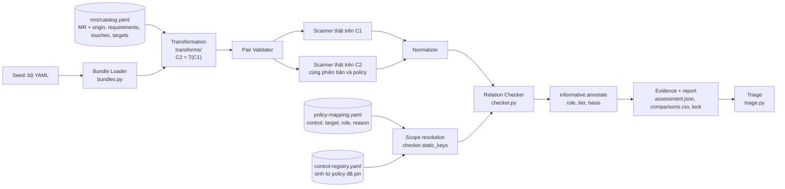

# Báo cáo PoC: Metamorphic Testing (MR-first) cho Trivy và Kubescape

Viết cho: giảng viên hướng dẫn — để đánh giá tiến độ và duyệt hướng nghiên cứu tiếp theo.
Số liệu chính thức lấy từ `docs/poc/POC_RESULTS.md` (sinh tự động từ `docs/evidence/poc_v2_2026-11-01/`, scanner thật, không mock). Kiến trúc: `docs/architecture/UNIFIED_FRAMEWORK.md`. Tác động của việc thống nhất lên số liệu: `docs/poc/MIGRATION_IMPACT_REPORT.md`.

## 1. Bài toán nghiên cứu

Trivy và Kubescape được dùng để phát hiện misconfiguration, nhưng chính scanner cũng có thể đánh giá sai khi nhiều resource tương tác
(ví dụ ghép `RoleBinding`–`Role`) hoặc khi cùng một quyền được biểu diễn theo cách khác. Khó khăn: không thể viết trước danh sách finding
đúng cho từng cấu hình (test oracle problem). Đề tài **kiểm thử độ đúng của scanner**, không phải tìm cấu hình sai trong một cluster.

Ba câu hỏi nghiên cứu: **RQ1 Applicability** (xây và áp dụng được những MR nào), **RQ2 Effectiveness** (phát hiện được loại lỗi nào, tin cậy ra sao),
**RQ3 Efficiency & Practicality** (chi phí sinh, thực thi, triage). Không có giả thuyết "MR tốt hơn random": bài Web về Metamorphic Testing cũng đánh giá
khả năng áp dụng, phát hiện lỗ hổng, specificity và chi phí chứ không đặt so với random làm điều kiện; so sánh đó nằm ở Future Work.

## 2. Phương pháp MR-first

Một MR là `(Precondition, Transformation, ExpectedRelation, Scope)` và đóng **hai vai trò**: (1) sinh follow-up `C2 = T(C1)` từ cấu hình nguồn `C1`;
(2) làm **oracle quan hệ**: cùng một scanner chạy trên `C1` và `C2`, findings được chuẩn hóa rồi kiểm `R(N(S(C1)), N(S(C2)))`.
Không có Semantic Oracle, SubjectAccessReview hay cluster trong pipeline (có test chặn việc thêm vào nhầm).

Ví dụ MR-02: RoleBinding ở `lab-a` trỏ Role cùng namespace; thêm Role **trùng tên** ở namespace khác, **không bind**. Theo RBAC, quyền của ServiceAccount không đổi,
nên verdict của control đánh giá nó phải bất biến. Cơ sở là quy tắc K8s "RoleBinding chỉ phân giải Role trong namespace của nó", không phải một oracle chạy kèm.

Nguyên tắc trung thực của khung: vắng finding **không** phải PASS; mọi cặp có trạng thái `PASS / PARTIAL / VIOLATION / SKIP / INVALID_PAIR / INCONCLUSIVE / SCAN_ERROR /
ENVIRONMENT_MISMATCH`; `VIOLATION` chỉ là alert, chưa là bug; "quan hệ thỏa" tách khỏi "verdict có quan sát được thuộc tính" (tier của từng so sánh).

**Dẫn xuất MR từ yêu cầu.** Yêu cầu cụ thể (`mrs/requirements.yaml`, R01–R10, trích nguyên văn từ tài liệu Kubernetes, gán nhóm OWASP K8s Top 10 2025 và lớp CWE) → property (`mrs/security_properties.yaml`) → pattern (`mrs/patterns.yaml`) → MR (`mrs/catalog.yaml`). Mỗi MR khai báo `origin` (prospective / retrospective / empirical / semantic / sanity) để không nhầm "gắn nhãn sau" với "dẫn xuất từ yêu cầu". Chỉ MR-09 là prospective (từ R08; dự đoán viết trước khi chạy, mục 6 của `docs/MR_DERIVATION_WALKTHROUGH_MR09.md`).

## 3. Những gì đã triển khai

**Một khung duy nhất** (mỗi khối là một module trong `src/k8s_mr_lab/`):

* Repo `k8s-mr-lab/`: loader YAML chặt, **9 MR** trên một giao diện (`@implements`), adapter gọi **Trivy 0.75.0 và Kubescape v4.0.15 thật** (offline, pin version + digest policy),
  hai normalizer, checker (`equal`/`pass_to_fail`/`fail_to_pass`), runner có provenance (commit, schema, digest, seed), triage.
* Một cơ chế ánh xạ: `policy-mapping.yaml` (MR→control→target, `role`, lý do, danh sách `unsupported` có lý do) cộng `control-registry.yaml` (control đọc/báo cáo trên kind nào, **sinh từ policy đã pin**). `mr validate` từ chối mapping mồ côi, khoảng trống im lặng, target chưa khai báo, vai trò sai.
* 224 test chạy cùng pipeline thật (unit, golden từ raw JSON thật, 3 integration chạy binary thật; ràng buộc kiến trúc ở `tests/unit/test_unified_framework.py`).
* Hạn chế PASS của Trivy: entry `PASS` không gắn resource; FAIL gắn bằng ánh xạ dòng, PASS chỉ là suy luận có nhãn `inferred_pass` (tier WEAK).

| MR | Biến đổi | Quan hệ | Nguồn gốc | Yêu cầu |
|---|---|---|---|---|
| MR-01 | đảo/sắp xếp thứ tự key YAML | `equal` | sanity | — |
| MR-02 | thêm Role trùng tên, không bind, ở namespace mới | `equal` | empirical | R06 (đủ) |
| MR-03 | tách rule nhiều verbs thành nhiều rule | `equal` | semantic | — |
| MR-04 | `privileged: false → true` | `pass_to_fail` | retrospective | R01 (đủ) |
| MR-05 | rule `secrets` core group → apiGroup `apps` | `fail_to_pass` | empirical | — |
| MR-06 | `hostNetwork: false → true` | `pass_to_fail` | retrospective | R02 (một phần) |
| MR-07 | subject `ServiceAccount` viết lại thành `User` | `equal` | empirical | — |
| MR-08 | dời subject sang namespace khác (kèm SA đồng hành) | `fail_to_pass` | empirical | — |
| MR-09 | verbs của rule Secrets thay bằng một verb đọc duy nhất | `equal` | prospective | R08 (đủ) |

MR-01..05 là MR cốt lõi; MR-06..09 là candidate (chạy khi gọi tường minh). Cột nhóm OWASP/CWE là mapping do đề tài tự gán qua yêu cầu (`mr trace`); OWASP không định nghĩa các MR này. Mã nhóm theo **bản 2025**.

Miền bao phủ: RBAC (MR-02/03/05/07/08/09) và một phần Pod Security (MR-04, MR-06). Yêu cầu: 3/10 có MR đủ, 1/10 một phần, 4/10 dẫn xuất được chưa làm, 2/10 không khả thi (`mr requirements`).

## 4. Thiết kế thực nghiệm

Tám thư mục seed (7 hợp lệ, 1 cố ý sai để kiểm `INVALID_SOURCE`; 6 nguồn hợp lệ duy nhất vì `K1-role-namespace` trùng nội dung với `rbac-workload`). Mỗi cặp chạy trên cả hai scanner
cùng version/mode/policy; nguồn được cache theo hash văn bản. Bằng chứng ở mức **DEV/REG (có định hướng)**: MR-02 và MR-05 được viết sau khi biết lớp lỗi K1/N2.
Bốn thí nghiệm, đều qua cùng một lệnh `run` và khối `experiment` trong lock: **baseline** (9 MR, hai scanner), **historical-defect** (MR-02 trên Kubescape v4.0.11 lỗi và v4.0.12 đã sửa, binary khớp checksum công bố), **mutation** (MR-09 trên bản sao `C-0015` bỏ verb `watch`), và lượt **độc lập** trên manifest của bên thứ ba (mục 5b).

## 5. Kết quả thực tế

Chi tiết và bảng: `docs/poc/POC_RESULTS.md`.

| | Trivy 0.75.0 | Kubescape v4.0.15 |
|---|---|---|
| Dòng kết quả | 73 | 77 |
| PASS / VIOLATION / PARTIAL / INCONCLUSIVE | 24 / 1 / 0 / 0 | 30 / 6 / 1 / 3 |
| SKIP | 47 (21 vì MR không có phạm vi Trivy) | 36 |
| SCAN_ERROR / ENVIRONMENT_MISMATCH | 0 / 0 | 0 / 0 |
| Lần gọi scanner | 28 | 39 |

> **Hai lưu ý khi đọc số liệu**
> 1. **PASS** nghĩa là *quan hệ MR được thỏa*, không có nghĩa scanner đã xác nhận resource an toàn.
> 2. **Ứng viên lỗi** nghĩa là hiện tượng đã tái hiện được và có bằng chứng kỹ thuật, nhưng *chưa kết luận chính thức* là lỗi scanner.

**RQ1 (Applicability).** 9 MR chạy qua cùng pipeline; MR nào không có control đánh giá đúng thuộc tính thì khai báo `unsupported` kèm lý do (MR-02, MR-07, MR-08 với Trivy). Lý do `SKIP` theo precondition: thiếu rule ≥ 2 verbs (6), không có Role chỉ-đọc-secrets (6), không có `hostNetwork: false` tường minh (6), không có Role Secrets get/list/watch (6), không có `privileged: false` tường minh (2), thiếu RoleBinding/SA liên kết (Kubescape: 10).

**RQ2 (Effectiveness).** Hai lớp lỗi K1 (Kubescape) và N2 (Trivy) được **chọn trước** để viết MR tái hiện, và cả hai tái hiện được (alert: Trivy 1, Kubescape 5 từ MR-02). Thêm: MR-07 cho một quan sát chưa phân loại (`C-0267` FAIL→PASS khi subject SA đổi thành `User`).
*Lỗi lịch sử KD-001 (kubescape#2579):* với phạm vi MR-02 chính thức, bản lỗi v4.0.11 cho 7 case VIOLATION, bản sửa v4.0.12 cho 5; 28 khóa khác nhau, đều ở `C-0015/0007/0035` trên `ServiceAccount`/`RoleBinding`, chỉ ở verdict follow-up (PASS→FAIL ở bản lỗi). Phạm vi cũ (Role đích) cho 5 so với 5, tức **không** phát hiện. KD-001 cùng lớp lỗi đã dẫn dắt MR-02 nên **không** thuộc mẫu số độc lập.
*Mutation:* lỗi tiêm vào `C-0015` (bỏ `watch`) bị MR-09 phát hiện ở đúng case đích `[watch]`, khớp dự đoán viết trước. Đây là 1 mutant, không phải mutation score.
`alert precision` và `specificity` **chưa đo**.

**RQ3 (Efficiency & Practicality).** Từ `results.csv` của baseline: sinh và kiểm tra cấu trúc tất cả cặp tốn ≈ 2,1 s (Trivy) và ≈ 2,9 s (Kubescape) tổng cộng; thời gian quét thật ≈ 74 s cho 28 lần gọi Trivy (≈ 2,6 s/lần) và ≈ 237 s cho 39 lần gọi Kubescape (≈ 6,1 s/lần); cache nguồn tiết kiệm 22 và 41 lần quét. Khối lượng triage thủ công: 7 alert → 5 input duy nhất (Trivy 1, Kubescape 4) → 3 nhóm (N2, K1, MR-07).
Thời gian người nghiên cứu bỏ ra để triage chưa được ghi nên không báo. Demo: `docs/poc/DEMO_GUIDE.md`.

## 5b. Lượt chạy độc lập trên manifest của bên thứ ba (đóng băng catalog)

**Thiết lập (quyết định trước khi chạy):** Kalm-Benchmark (Dynatrace, commit `dac3df5`), do người khác viết, chưa từng dùng để thiết kế hay chỉnh MR. 65 file chọn theo quy tắc cố định (bỏ file bắt đầu bằng `_`, lấy mỗi file thứ 4, cộng mọi file mà MR-02/03/05 áp dụng được), giống hệt lượt đầu. Digest catalog, mapping, registry, config và toàn bộ code được ghi vào `freeze.json` trước khi chạy và **còn nguyên sau khi chạy** (`FREEZE INTACT`). Chạy bằng khung thống nhất với cả 9 MR.

| Mỗi scanner | Trivy 0.75.0 | Kubescape v4.0.15 |
|---|---|---|
| Seed / dòng kết quả | 65 / 613 | 65 / 616 |
| PASS / VIOLATION / PARTIAL / INCONCLUSIVE | 163 / 3 / 0 / 6 | 81 / 0 / 65 / 37 |
| Tỉ lệ cặp có kết luận (PASS+VIOLATION) | 166/172 = 97% | 81/183 = 44% |
| Lần gọi scanner / quét tiết kiệm nhờ cache | 238 / 110 | 247 / 119 |
| Tổng thời gian quét | ≈ 739 s | ≈ 1116 s |

**Đọc kết quả thế nào:**
* **Trivy:** 3 violation MR-05 trên `rbac-002-1/2/3` (ba biến thể của cùng kịch bản N2) → **một họ**, không phải ba lỗi; cho thấy N2 không phải sản phẩm của seed tự viết, nhưng MR-05 vốn được viết sau khi biết N2. MR-01 91 PASS (+4 INCONCLUSIVE vì FAIL không có số dòng), MR-04 và MR-06 gần như toàn PASS. Không quan sát violation ở MR-01 và MR-04: chưa đủ để kết luận tỉ lệ cảnh báo giả bằng 0.
* **Kubescape:** 0 violation. **65 PARTIAL của MR-01 là hệ quả của việc thống nhất registry** (không phải lỗi scanner): `ALL_OF_KIND` của control aggregator nay gồm cả `ServiceAccount`/`RoleBinding`, và một `ServiceAccount` không thuộc bộ ba nào được cả hai phía báo `NOT_EVALUATED`. Lượt cũ báo PASS cho các cặp này vì phạm vi hẹp hơn. Không khóa so sánh nào có mặt ở cả hai lượt đổi verdict (`MIGRATION_IMPACT_REPORT.md`). Đây là điểm yếu phạm vi của MR-01 cần xử lý (mục 8).
* **K1 không xuất hiện** (cần SA + RoleBinding + workload; Kalm gần như không có tổ hợp này). Hạn chế về seed, không phải bằng chứng lỗi hiếm.
* **Áp dụng:** 24% (Trivy) và 25% (Kubescape) số (seed, MR). MR RBAC cần seed có nhiều resource liên kết mà benchmark đơn-lỗi không cung cấp.
* **INCONCLUSIVE là trung thực:** Trivy 6 cặp có FAIL không số dòng nên không gắn được resource; Kubescape 37 cặp mà các control RBAC không phát verdict cho Role/ServiceAccount không được bind, framework báo INCONCLUSIVE thay vì PASS.
* **Chi phí:** 0 `SCAN_ERROR`.

**Giới hạn:** một benchmark; 65/238 file **không phải mẫu ngẫu nhiên**; chưa có adjudication thủ công. Lock của lượt này ghi `dirty: true` do một sửa chữ trong `scripts/make_evidence_pack.py` chưa commit lúc chạy (ngoài danh sách đóng băng). Không dùng kết quả này làm tỉ lệ phát hiện lỗi hay tỉ lệ cảnh báo giả.

**Tái lập:** `bash scripts/heldout_run.sh` sau `python scripts/heldout_prepare.py` (cần `~/Kalm-Benchmark` ở commit `dac3df5`); `docs/evidence/poc_v2_2026-11-01/{freeze,selection}.json`.

## 6. Phân tích các ứng viên và lỗi lịch sử

Chi tiết, ablation và các khả năng đã loại trừ: `docs/DEFECT_TRIAGE_RESULTS.md` (trạng thái `READY_FOR_HUMAN_ADJUDICATION`); KD-001: `docs/KD001_REPRODUCTION.md`.

1. **Kubescape, MR-02 (lớp K1).** Role decoy không bind làm `C-0267` (và `C-0272` với profile wildcard) của workload đổi `passed → failed`. Rule rego ghép Role–RoleBinding theo tên và bỏ qua namespace;
   raw JSON liệt kê Role decoy trong `relatedResourcesIDs` của alert. Cùng lớp lỗi với kubescape#2579 nhưng **không chứng minh cùng nguyên nhân gốc** (K1 ở rego tự join của C-0267/C-0272, KD-001 ở aggregator Go).
2. **Trivy, MR-05 (lớp N2).** `KSV-0113` vẫn FAIL khi `apiGroups: ["apps"]`; rego không chứa `apiGroups`. Kubescape xử lý đúng cùng cặp.
3. **Kubescape, MR-07 (quan sát chưa phân loại).** `C-0267` FAIL→PASS khi subject SA viết lại thành `User` cùng tên; chưa biết là lỗi hay hành vi chủ đích (cần đọc tài liệu control/hỏi upstream).
4. **KD-001** (xem trên): lỗi lịch sử có thật, tái hiện trên binary chính thức; giá trị là chứng minh quy trình phát hiện được lỗi đã công bố khi phạm vi so sánh đúng, và phát hiện **khoảng cách phạm vi** của MR-02 cũ.

Các mục 1–2 là lớp lỗi đã biết trước (guided), không gọi là phát hiện mới.

## 7. Những giới hạn

* Phần DEV/REG là có định hướng và số seed nhỏ (6 nguồn hợp lệ duy nhất). Lượt độc lập (mục 5b) là một mẫu của một benchmark, MR RBAC hầu như không áp dụng được ở đó.
* Chưa có adjudication thủ công, chưa có lỗi đã biết **độc lập** (K1, N2, KD-001 đều đã dùng để định hình MR): **không** báo tỉ lệ phát hiện, alert precision hay specificity. Chưa có review MR độc lập (mọi property `author_reviewed`).
* MR bất biến bỏ sót lỗi sai nhất quán; Trivy PASS là suy luận (tier WEAK): với Trivy phần lớn kết quả "PASS" nghĩa là "tập FAIL không đổi".
* MR-02 không có phạm vi Trivy: mọi check Trivy được ánh xạ chỉ nhìn document của chính nó. Đó là kết quả về khả năng quan sát, không phải bằng chứng Trivy đúng.
* Kubescape báo kết quả RBAC theo từng bộ ba (subject, Role, RoleBinding); normalizer gán verdict cho từng thành viên. Chưa kiểm ClusterRole, nhiều subject trong một binding, group.
* Validator nguồn chỉ kiểm cấu trúc; kết luận chỉ hợp lệ ở chế độ quét manifest cục bộ. Chỉ một phiên bản mỗi scanner (ngoại trừ KD-001).
* Gom họ lỗi (`family`) là heuristic. Điều kiện quan sát được của control là điều kiện cần, không đủ (`docs/INFORMATIVE_COMPARISON_ANALYSIS.md`).
* Mutation: một mutant, một control.

## 8. Kết luận và kế hoạch nghiên cứu tiếp theo

**Kết luận.** Framework hiện có **một** đặc tả MR, **một** cơ chế ánh xạ/scope, **một** pipeline và **một** bộ kết quả; thêm MR chỉ cần mục catalog, entry mapping, một class và test. Chín MR chạy trên hai scanner thật: 1 + 6 alert (hai họ ứng viên K1/N2 và một quan sát MR-07), lỗi lịch sử KD-001 tái hiện đúng khi phạm vi so sánh đúng, một lỗi tiêm bị bắt. Các hiện tượng tái hiện được và có bằng chứng, nhưng đây là kiểm thử có định hướng, chưa phải phát hiện lỗi mới và chưa phải tỉ lệ phát hiện.

| Ưu tiên | Việc | Mục đích |
|---|---|---|
| 1 | Review độc lập MR (`docs/INDEPENDENT_MR_REVIEW_PROTOCOL.md`) và adjudicate K1, N2, MR-07; tra issue/PR upstream cho N2 và K1 | Chuyển candidate → confirmed/không; biết phân loại MR-07 |
| 2 | Tìm ≥ 1 lỗi đã biết **độc lập** (chưa dùng để thiết kế MR) và chốt trước khi xem kết quả MT | Có mẫu số cho tỉ lệ phát hiện (RQ2) |
| 3 | Thu hẹp phạm vi `ALL_OF_KIND` của MR-01 (chỉ đối tượng có verdict ở ít nhất một phía, hoặc tách `judges` khỏi `reports_on` trong registry) rồi chạy lại toàn bộ như một thay đổi có báo cáo tác động | Loại bỏ nhiễu PARTIAL của MR-01 trên Kubescape (mục 5b) |
| 4 | Hệ thống hóa RQ1 theo yêu cầu: dẫn xuất MR cho các yêu cầu DERIVABLE (R03, R04, R07, R10) theo quy trình prospective | Chứng minh phương pháp mở rộng được, có căn cứ chọn MR |
| 5 | Mở rộng seed có liên kết RBAC đầy đủ (6 nguồn duy nhất còn ít), ghi thời gian triage | RQ2/RQ3 đầy đủ hơn |
| Sau | Live-cluster scanning; so sánh random/schema-aware; Semantic Oracle độc lập | Future Work |
